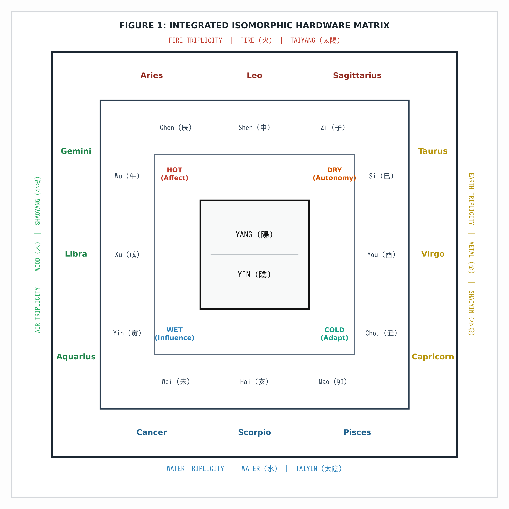
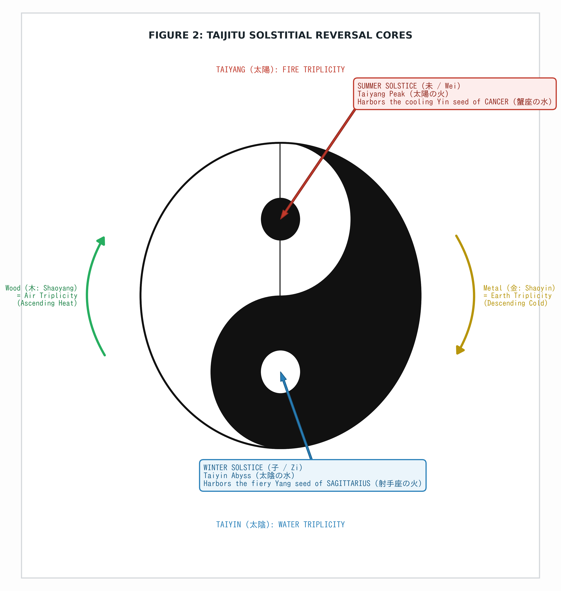
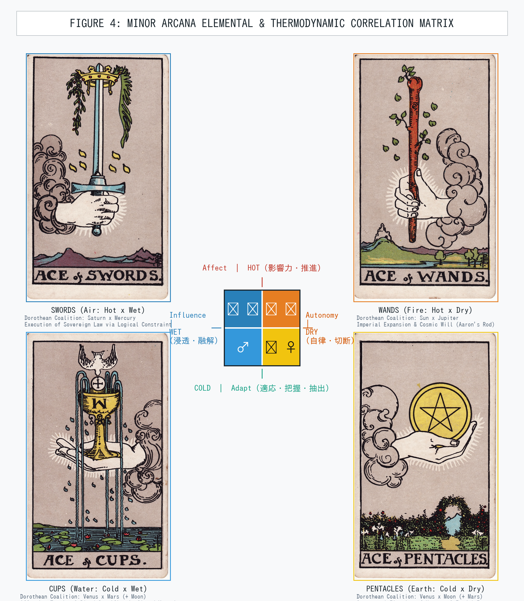

# The Isomorphic Hardware of Occult Systems (Version 1.0)

> **A Deterministic Mechanical Architecture Unifying Aristotelian Physical Primitives, Dorothean Triplicities, and Wu Xing Dynamics**

[](SPECIFICATION.md)
[-success.svg)](#audit-verdict)
[](LICENSE)

---

## Authors & Affiliation
- **Lead Theorist:** Polar Mikami (Studio uranaisu)
- **Systems Architecture & Compiler Implementation:** Nanota Yuzu (Studio uranaisu)
- **Date of First Publication:** November 11, 2026
- **Repository:** [uranaisu-g/isomorphic-occult-hardware](https://github.com/uranaisu-g/isomorphic-occult-hardware)

---

## Executive Summary

For two millennia, traditional astrological and occult systems have suffered from continuous narrative degradation, regressing into moralistic, psychological, and subjective folklore. 

This repository establishes the **immutable Version 1.0 specification** that deconstructs these ancient frameworks into a single, cohesive, deterministic computational hardware model based strictly on:
1. **Four Aristotelian Thermodynamic Primitives:** Hot (Affect/Thrust), Cold (Adapt/Seizure), Dry (Severance/Grid), and Wet (Permeation/Liquid).
2. **Pamela Colman Smith's 1909 Anatomical/Chromatic Encoding:** The absolute mathematical derivation of the Rider-Waite-Smith Minor Arcana Aces through hand anatomy (Clenched Fist vs. Open Palm) and chromatic vectors.
3. **Dorothean Planetary Triplicity Engines:** Hellenistic three-planetary coalitions (e.g., Venus + Mars + Moon) operating as high-friction structural mechanisms.
4. **Isomorphism with Chinese Wu Xing Dynamics:** The materialist thermodynamic proof that **"Metal is Earth" (金は土)** via the physics of the agricultural harvest (desiccation and cold storage), and the sociological proof of **"Wood is Air" (木は風)**.
5. **Taijitu Solstitial Reversal Cores:** The mathematical unification of the ancient Yin-Yang "Fish Eyes" anchored at True North (0° Capricorn / Winter Solstice harboring Sagittarius Fire) and True South (Summer Solstice harboring Cancer Moisture).
6. **Topological Invariants:** Proof that Eastern **Six Harmonies (支合)** are identical to Hellenistic **Solstitial Antiscia (赤緯パラレル)**, and **Six Clashes (冲)** are identical to **Astrological Oppositions (180°)**.

---

## Repository Structure

```
.
├── README.md                      # Executive overview and quickstart
├── SPECIFICATION.md               # Complete academic specification paper (v1.0)
├── CITATION.cff                   # Citation metadata for academic indexing
├── LICENSE                        # Dual MIT / Creative Commons Attribution 4.0
├── compiler/
│   └── core_primitives.py         # Python reference compiler & validation assertions
└── figures/
    ├── figure1_integrated_matrix.png       # Integrated nested hardware matrix
    ├── figure2_taijitu_solstice.png        # Taijitu solstitial reversal cores
    ├── figure3_celestial_compass.png       # 24-solar-term celestial compass
    └── figure4_minor_arcana_matrix.png     # Minor Arcana Aces x Dorothean engines
```

---

## Architectural Diagrams

### Figure 1: Integrated Isomorphic Hardware Matrix


### Figure 2: Taijitu Solstitial Reversal Cores


### Figure 4: Minor Arcana Aces & Dorothean Planetary Engines


---

## Python Reference Compiler Quickstart

The reference compiler provides automated verification against poetic narrative drift:

```bash
cd compiler
python3 core_primitives.py
```

### Programmatic Assertion Example

```python
from compiler.core_primitives import UniversalOccultCompiler, KernelViolationError

# Valid structural statement (PASSES)
valid_stmt = "The Ace of Swords executes sovereign structural constraint via Saturn-Mercury mechanics."
assert UniversalOccultCompiler.validate_statement(valid_stmt)

# Narrative poetic contamination (RAISES KernelViolationError)
try:
    invalid_stmt = "The Cup represents emotional healing vibe and unconditional love."
    UniversalOccultCompiler.validate_statement(invalid_stmt)
except KernelViolationError as e:
    print("System Fault Cleared:", e)
```

---

## Citation & Academic Prior Art

If referencing or deriving from this specification, please cite:

```bibtex
@misc{mikami2026isomorphic,
  author = {Mikami, Polar and Yuzu, Nanota},
  title = {The Isomorphic Hardware of Occult Systems: Unifying Aristotelian Physical Primitives, Dorothean Triplicities, and Wu Xing Dynamics (Version 1.0)},
  year = {2026},
  publisher = {GitHub},
  journal = {GitHub repository},
  howpublished = {\url{https://github.com/uranaisu-g/isomorphic-occult-hardware}}
}
```

---

## License

This project is dual-licensed under:
- **MIT License** for code and programmatic implementations (`compiler/`).
- **Creative Commons Attribution 4.0 International (CC BY 4.0)** for textual specifications and diagrams (`SPECIFICATION.md`, `figures/`).
