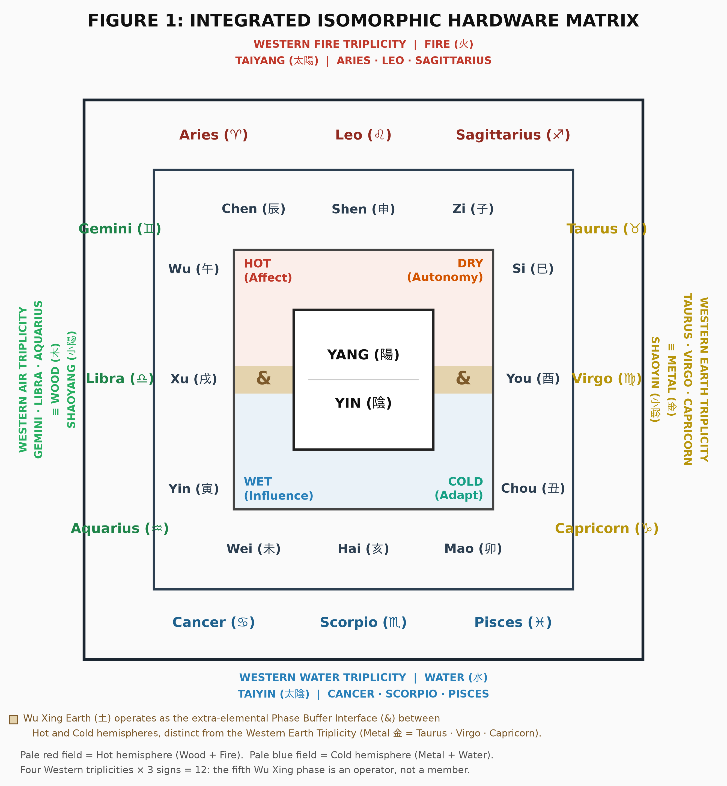
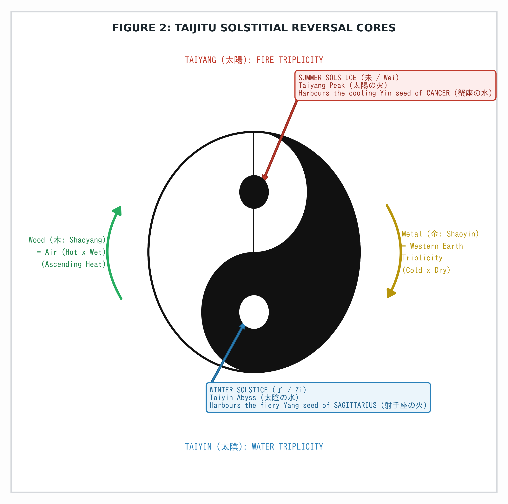
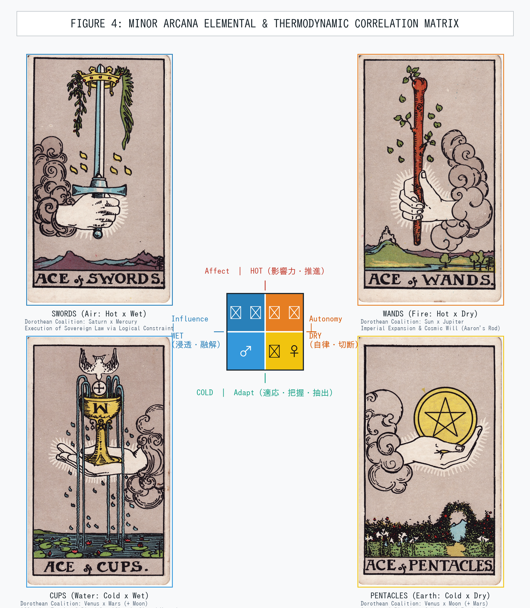

# The Isomorphic Hardware of Occult Systems (Version 1.1)

> **A Deterministic Mechanical Architecture Unifying Aristotelian Physical Primitives, Dorothean Triplicities, and Wu Xing Dynamics**

[](SPECIFICATION.md)
[-success.svg)](#audit-verdict)
[](LICENSE)

---

## Authors & Affiliation
- **Lead Theorist:** Polar Mikami (Studio uranaisu)
- **Systems Architecture & Compiler Implementation:** Nanota Yuzu (Studio uranaisu)
- **Date of First Publication:** November 11, 2026
- **Revision:** November 21, 2026 (Version 1.1)
- **Repository:** [uranaisu-g/isomorphic-occult-hardware](https://github.com/uranaisu-g/isomorphic-occult-hardware)

---

## Executive Summary

For two millennia, traditional astrological and occult systems have suffered from continuous narrative degradation, regressing into moralistic, psychological, and subjective folklore.

This repository establishes the **immutable Version 1.1 specification** that deconstructs these ancient frameworks into a single, cohesive, deterministic computational hardware model based strictly on:
1. **Four Aristotelian Thermodynamic Primitives:** Hot (Affect/Thrust), Cold (Adapt/Seizure), Dry (Severance/Grid), and Wet (Permeation/Liquid).
2. **Pamela Colman Smith's 1909 Anatomical/Chromatic Encoding:** The absolute mathematical derivation of the Rider-Waite-Smith Minor Arcana Aces through hand anatomy (Clenched Fist vs. Open Palm) and chromatic vectors.
3. **Dorothean Planetary Triplicity Engines:** Hellenistic three-planetary coalitions (e.g., Venus + Mars + Moon) operating as high-friction structural mechanisms.
4. **Isomorphism with Chinese Wu Xing Dynamics:** The materialist thermodynamic proof that **"Metal is Earth" (金は土)** via the physics of the agricultural harvest (desiccation and cold storage), and the sociological corroboration of **"Wood is Air" (木は風)**.
5. **Taijitu Solstitial Reversal Cores:** The mathematical unification of the ancient Yin-Yang "Fish Eyes" anchored at True North (0° Capricorn / Winter Solstice harboring Sagittarius Fire) and True South (Summer Solstice harboring Cancer Moisture).
6. **Topological Invariants:** Proof that Eastern **Six Harmonies (支合)** are identical to Hellenistic **Solstitial Antiscia (declination parallels)**, and **Six Clashes (冲)** are identical to **Astrological Oppositions (180°)**.

### One name, two things: Western Earth vs. Wu Xing Earth

The specification uses two expressions that must never be swapped:

| Term | What it is | Where it appears |
| :--- | :--- | :--- |
| **Western Earth Triplicity** | Taurus / Virgo / Capricorn = Cold × Dry = **Metal (金)**. A zodiacal element and the Pentacles suit. | §§3, 4.4, 5.1, Figure 1 |
| **Wu Xing Earth (土)** | The extra-elemental **Phase Buffer Interface (`&`)** between the Hot and Cold hemispheres. No sign, no triplicity, no suit: an operator, not a member. | §§5.1, 5.4, 6 |

The count asymmetry that follows — four elements, four three-gear engines, one operator — is treated in §5.4 as the structural proof of the `&`, not as a hole in the mapping. Version 1.1 applies this distinction throughout the paper, the reference compiler (`assert_terminology()`) and Figure 1.

---

## Repository Structure

```
.
├── README.md                      # Executive overview and quickstart
├── SPECIFICATION.md               # Complete academic specification paper (v1.1)
├── CITATION.cff                   # Citation metadata for academic indexing
├── LICENSE                        # Dual MIT / Creative Commons Attribution 4.0
├── compiler/
│   └── core_primitives.py         # Python reference compiler & validation assertions
└── figures/
    ├── figure1_integrated_matrix.png       # Integrated nested hardware matrix
    ├── figure2_taijitu_solstice.png        # Taijitu solstitial reversal cores
    ├── figure3_celestial_compass.png       # 24-solar-term celestial compass
    └── figure4_minor_arcana_matrix.png     # Minor Arcana Aces x Dorothean engines
```

---

## Architectural Diagrams

### Figure 1: Integrated Isomorphic Hardware Matrix


### Figure 2: Taijitu Solstitial Reversal Cores


### Figure 4: Minor Arcana Aces & Dorothean Planetary Engines


---

## Python Reference Compiler Quickstart

The reference compiler provides automated verification against poetic narrative drift:

```bash
cd compiler
python3 core_primitives.py
```

### Programmatic Assertion Example

```python
from compiler.core_primitives import UniversalOccultCompiler, KernelViolationError

# Valid structural statement (PASSES)
valid_stmt = "The Ace of Swords executes sovereign structural constraint via Saturn-Mercury mechanics."
assert UniversalOccultCompiler.validate_statement(valid_stmt)

# Narrative poetic contamination (RAISES KernelViolationError)
try:
    invalid_stmt = "The Cup represents emotional healing vibe and unconditional love."
    UniversalOccultCompiler.validate_statement(invalid_stmt)
except KernelViolationError as e:
    print("System Fault Cleared:", e)

# v1.1 terminology guard: Wu Xing Earth (土) owns no zodiacal triplicity
assert UniversalOccultCompiler.assert_terminology()
```

---

## What Changed in Version 1.1 (2026-11-21)

- **Terminology split** between the *Western Earth Triplicity* (Taurus / Virgo / Capricorn ≡ Metal 金) and *Wu Xing Earth (土)*, applied in §§4.4, 5.1, 5.4, 6, Figure 1 and this README. The compiler key `METAL_EARTH` is now `METAL_WESTERN_EARTH`, and `EARTH_BUFFER["root_signs"]` is explicitly `None`.
- **§5.1:** the duplicated "Physics of the Harvest" passage removed; the argument now appears once, numbered.
- **§5.3 / §5.4:** duplicate section number repaired (the second 5.3 is now 5.4).
- **§2.1:** the Cold primitive supported by the *Cold Reading / Cold Case / Cold-Pressed* triad — no heat added, object received whole.
- **§5.4:** the 4-versus-3 count asymmetry written out as the structural proof of the `&` operator.
- **§5.1:** Gou no Tora (五黄の寅) and Hinoeuma (丙午) marked as sociological corroboration (社会的傍証), not as a deductive derivation.
- **§6:** the listing is now byte-identical to `compiler/core_primitives.py` v1.1, which executes cleanly and passes `assert_terminology()`. The README example above imports successfully again (v1.0's file did not define `UniversalOccultCompiler`).
- **Figure 1:** relabelled (`WESTERN EARTH TRIPLICITY · TAURUS · VIRGO · CAPRICORN ≡ METAL (金)`), the `DRY (Autonomy)` label no longer crosses the primitives frame, and the Wu Xing Earth buffer band is drawn between the Hot and Cold hemispheres.
- **Proofreading:** planetary glyphs replaced by Unicode (GitHub-flavoured Markdown cannot render `\jupiter`, `\saturn` and the like), the repository identifier corrected, and the Zi (子) double-hour corrected to 23:30–01:30.

---

## Citation & Academic Prior Art

If referencing or deriving from this specification, please cite:

```bibtex
@misc{mikami2026isomorphic,
  author = {Mikami, Polar and Yuzu, Nanota},
  title = {The Isomorphic Hardware of Occult Systems: Unifying Aristotelian Physical Primitives, Dorothean Triplicities, and Wu Xing Dynamics (Version 1.1)},
  year = {2026},
  publisher = {GitHub},
  journal = {GitHub repository},
  note = {First release November 11, 2026; revised November 21, 2026},
  howpublished = {\url{https://github.com/uranaisu-g/isomorphic-occult-hardware}}
}
```

---

## License

This project is dual-licensed under:
- **MIT License** for code and programmatic implementations (`compiler/`).
- **Creative Commons Attribution 4.0 International (CC BY 4.0)** for textual specifications and diagrams (`SPECIFICATION.md`, `figures/`).
