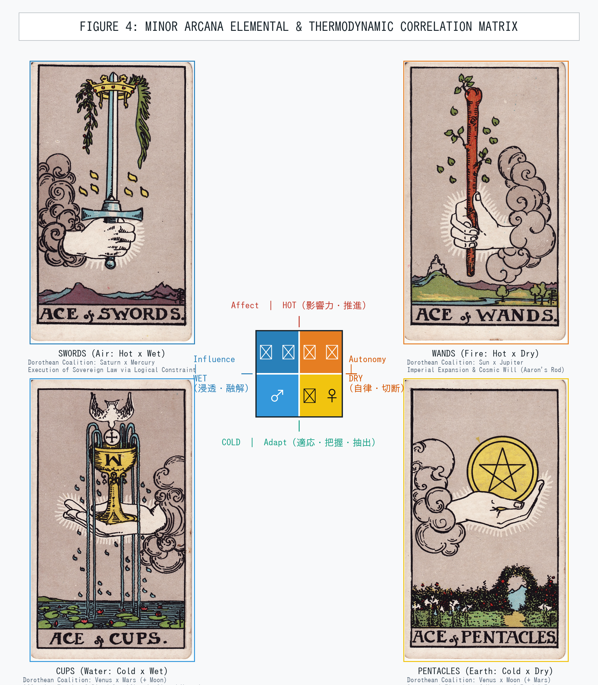
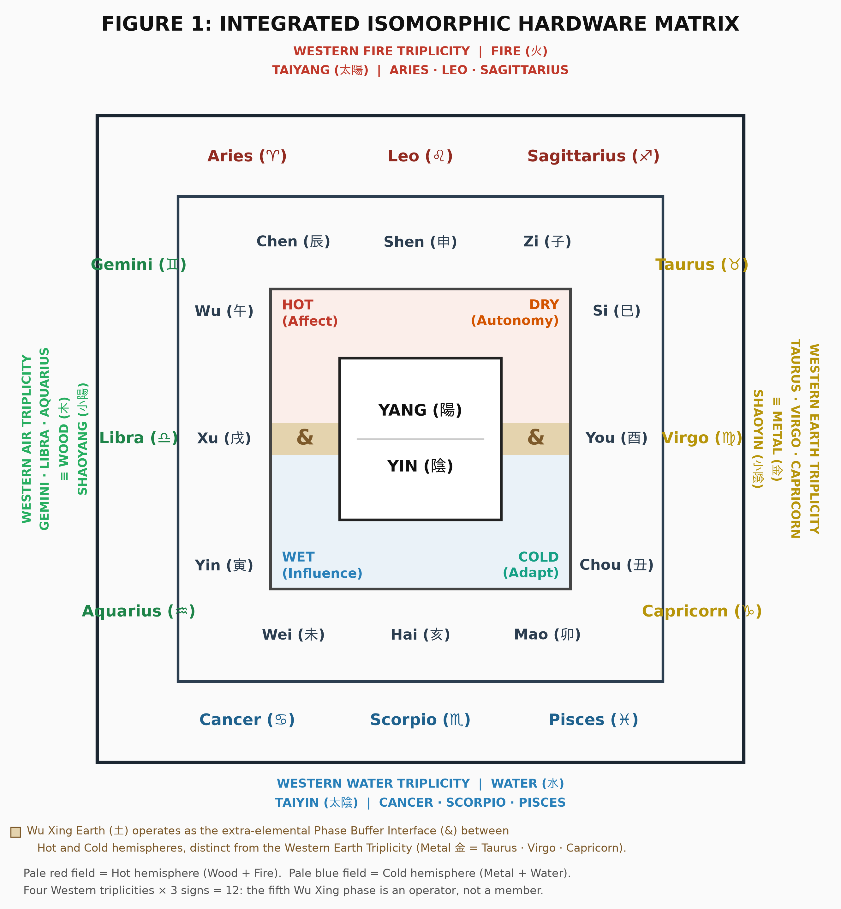
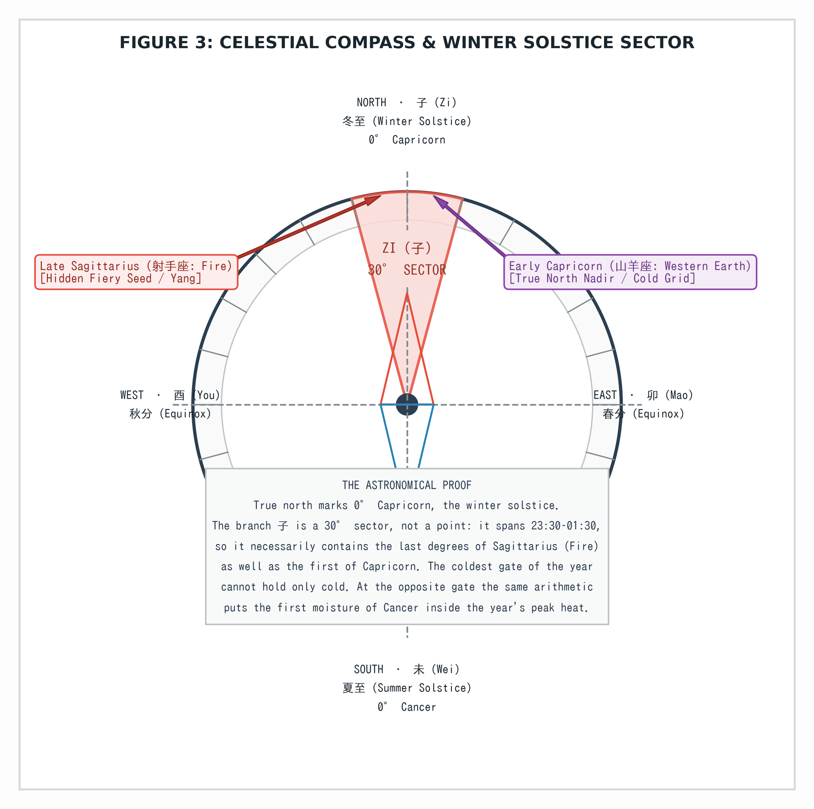

# The Isomorphic Hardware of Occult Systems: Unifying Aristotelian Physical Primitives, Dorothean Triplicities, and Wu Xing Dynamics (Version 1.1)

**Authors:** Polar Mikami (Lead Theorist & Discoverer, Studio uranaisu), Nanota Yuzu (System Architecture & Verification)  
**Date of First Publication:** November 11, 2026  
**Revision:** Version 1.1 — November 21, 2026  
**Document Type:** Formal System Specification & Research Preprint  
**Repository Identifier:** `uranaisu-g/isomorphic-occult-hardware`  

### Revision History

| Version | Date | Change |
| :--- | :--- | :--- |
| 1.0 | 2026-11-11 | Initial public release. |
| 1.1 | 2026-11-21 | Terminology separated: **Western Earth Triplicity** (Taurus / Virgo / Capricorn ≡ Metal 金) versus **Wu Xing Earth (土)** (the extra-elemental buffer `&`), applied throughout §§4.4, 5.1, 5.4, 6 and Figure 1. §5.1: the duplicated "Physics of the Harvest" passage removed. §5.3 / §5.4: duplicate section number repaired. §2.1: the Cold primitive supported by the Cold Reading / Cold Case / Cold-Pressed proof. §5.4: the 4-versus-3 count asymmetry stated as structural proof of the `&` operator. §5.1: Gou no Tora / Hinoeuma marked as sociological corroboration, not derivation. §6: listing synchronised with `compiler/core_primitives.py` v1.1, which now executes and passes its own terminology assertions. Figure 1 relabeled and redrawn (label collisions fixed). Proofreading: planetary glyphs replaced by Unicode, repository identifier corrected, Zi double-hour corrected to 23:30–01:30. |

---

## Abstract

Traditional cosmological and metaphysical frameworks—specifically Hellenistic astrology, Pamela Colman Smith’s 1909 Tarot geometry, and classical Chinese Wu Xing (Five Elements)—have been historically obscured by centuries of moralistic, psychological, and narrative distortion. This paper formalizes these traditions not as mystical divination or human-centric symbolism, but as an **isomorphic, deterministic hardware architecture** derived strictly from four foundational thermodynamic and optical primitives: **Hot (H)**, **Cold (C)**, **Dry (D)**, and **Wet (W)**.

By auditing the four elemental Aces in the Rider-Waite-Smith (RWS) deck, we demonstrate how Pamela Colman Smith encoded exact Aristotelian mechanics through physical hand morphology (clenched fist vs. open palm) and chromatic optical vectors (warm hard-edged contours vs. cool diffuse gradients). Furthermore, we establish the functional equivalence between Hellenistic Dorothean triplicity rulerships and the four elemental suits, proving that the planetary engines driving each suit are structural mechanisms rather than arbitrary allegories.

Finally, we prove the exact geometric isomorphism between the Western Earth triplicity (Taurus, Virgo, Capricorn) and the Eastern Metal Trinity (巳-酉-丑 三合金局), revealing that the Chinese cosmological axiom "Earth generates Metal" (土生金) is a thermodynamic description of the agricultural harvest: the desiccation (Dry) and cooling (Cold) of organic yield into permanent, immutable material wealth. In addition, the astronomical alignment of the solstitial reversal cores—the "Fish Eyes" of the Taijitu located at the Winter Solstice (子 / Sagittarius fire seed) and Summer Solstice (未 / Cancer water seed)—is mathematically unified within this coordinate plane.

Throughout this paper two things that English and Japanese both call "Earth" are kept strictly apart: the **Western Earth Triplicity** (Taurus, Virgo, Capricorn; Cold × Dry ≡ Metal 金), which is a zodiacal element and a Tarot suit, and **Wu Xing Earth (土)**, which is not an element at all but the extra-elemental phase buffer interface (`&`) between the Hot and Cold hemispheres. The count asymmetry that follows from this distinction (four elements, four three-gear engines, one operator) is treated in §5.4 not as a hole in the mapping but as its proof.

This paper provides the complete mathematical, physical, and programmatic definitions required to eliminate post-hoc narrative interpretation, establishing a non-arbitrary computational ontology for ancient metaphysical mechanics.

---

## 1. Introduction: De-narrativizing Occult Systems

For over two millennia, the study of ancient cosmology has suffered from progressive degradation. What began in Alexandria, Mesopotamia, and pre-Han China as a rigorous phenomenology of nature, optical geometry, and seasonal thermodynamics has devolved into psychological projection, moralizing parables, and fatalistic fortune-telling.

Modern psychological astrology and pop-tarot describe elements using emotional narratives:
- Water is reduced to "empathy and kindness."
- Earth is labeled "stability and stubbornness."
- Fire is moralized as "passion and rage."
- Air is romanticized as "pure intellect."

Such classifications are computationally non-reproducible and logically incoherent. They represent post-hoc rationalizations that mistake downstream psychological manifestations for upstream mechanical causes.

To restore structural rigor, we introduce a strict design axiom:
$$\text{Phenomenon} = f(\text{Physical Primitives}) \quad \text{where} \quad \text{Narrative} \equiv \emptyset$$

Every house, sign, aspect, triplicity, and suit must be strictly deducible from physical and optical constraints. If an interpretation relies on human sentiment, divine whim, or moral karma, it is classified as a corrupted computational state and purged.

---

## 2. Core Thermodynamic & Optical Primitives

All dynamics in this unified model originate from two orthogonal axes of Aristotelian physics, redefined here as operational mechanical vectors:

```
                  HOT (Affect / Forward Thrust)
                               |
               Air             |            Fire
          (Hot x Wet)          |        (Hot x Dry)
                               |
  WET -------------------------+------------------------- DRY
(Influence / Permeation)       |                   (Autonomy / Segmentation)
                               |
              Water            |      Earth Tripl. ≡ Metal
          (Cold x Wet)         |         (Cold x Dry)
                               |
                 COLD (Adapt / Vacuum Capture)
```

### 2.1. Operational Vector Definitions

1. **HOT ($\mathcal{H}$): Forward Thrust / High Internal Pressure / Active Deformation**
   - **Mechanical Vector:** Internal pressure directed aggressively outward.
   - **Physical Action:** Clenched fist ($\mathcal{F}_{ist}$), striking blade, or combustion chamber.
   - **Functional Definition:** Forces physical deformation, fracture, or displacement upon the external environment. Hot systems disregard external resistance, maintaining internal momentum to overwrite surrounding reality through sheer output.
   - **Systemic Law:** *Victory belongs to the agent capable of generating internal pressure and forcibly altering the external environment.*

2. **COLD ($\mathcal{C}$): Vacuum Extraction / Frictionless Adaptation / Absolute Seizure**
   - **Mechanical Vector:** The complete evacuation of internal heat, anticipation, and subjective bias (Absolute Zero thermal noise).
   - **Physical Action:** Open palm ($\mathcal{P}_{alm}$), frictionless plane, or vacuum claw.
   - **Functional Definition:** A zero-resistance intake mechanism that pulls in external targets whole, seals escape vectors, and extracts raw data/substance down to the sub-millimeter without altering its inherent physical structure.
   - **Etymological Proof — the Cold Triad:** English preserves this mechanism in three independent compounds, each naming the same operation in a different domain:
     - **Cold Reading** (epistemology): the reader arrives without a pre-cooked hypothesis, without a desired answer, without the performer’s need to be right. What is removed is the observer’s heat; what is extracted intact is the subject’s actual verbal and somatic signal.
     - **Cold Case** (forensic practice): the file is reopened once the heat of the rushed verdict, the public pressure, and the story that closed it have cooled. What is extracted intact is the evidence as it physically stands, legible decades later.
     - **Cold-Pressed** (thermodynamics of matter): the fruit is not cooked, so thermal agitation does not oxidize or denature it. What is extracted intact is the whole raw content, structurally unaltered.
     - **Shared core:** in all three, "cold" does not mean weak, passive, or indifferent. It means **no heat is added** — no preconception, no thermal agitation, no subjective bias, no narrative interference. The operator refuses to cook the object before reading it, and therefore receives it whole. Heat flavors the sample with the observer; cold delivers the sample.
   - **Real-World Isomorphisms:** Cold Reading (extracting data without pre-cooked hypotheses), Cold Case (reading a file whose story has cooled), Cold-Pressed extraction (drawing pure oil without thermal degradation), the Grip of the Kidnapper or the Art Thief (stealing an asset entirely intact, preserving its market value without fracturing its form).
   - **Axiomatic Warning:** $\mathcal{C}$ *is not passive yielding, feminine softness, or moral kindness. It is a ruthless, unyielding mechanism of whole-object capture and extraction.*
   - **Systemic Law:** *Victory belongs to the agent capable of shedding internal bias and proactively assimilating external reality.*

3. **DRY ($\mathcal{D}$): Hard Boundary / Absolute Segmentation / Autonomy**
   - **Optical / Chromatic Vector:** Hard edge, sharp contour, high-contrast warm chroma.
   - **Functional Definition:** Solidifies surfaces and refuses chemical or energetic fusion between distinct elements. It establishes irreversible structural boundaries, carving reality into discrete, non-permeable categories.

4. **WET ($\mathcal{W}$): Fluid Interface / Boundary Liquefaction / Influence**
   - **Optical / Chromatic Vector:** Boundary dissolution, soft gradient, diffuse cool chroma.
   - **Functional Definition:** Liquefies rigid interfaces, allowing elements to mix, dissolve, and permeate one another. It bypasses frontal collision through capillary infiltration and dynamic spatial blending.

---

## 3. The Geometry of the Four Aces: Pamela Colman Smith’s Physical Proof

In 1909, artist and occult scholar Pamela Colman Smith illustrated the 78 cards of the RWS Tarot under the nominal direction of Arthur Edward Waite. While Waite’s accompanying text remained steeped in Victorian mysticism, Smith embedded an exact optical and anatomical proof of Aristotelian thermodynamic physics within the four Aces.

In each Ace, a divine hand emerges from a cloud. Modern interpreters treat these hands as identical symbols of "divine gift." A rigorous anatomical and optical audit reveals a deterministic mapping:

| Elemental Suit | Aristotelian State | Hand Morphology | Chromatic & Contour Physics | Mechanical Vector |
| :--- | :--- | :--- | :--- | :--- |
| **Ace of Wands** | $\text{Fire} = \mathcal{H} \times \mathcal{D}$ | **Clenched Fist** ($\mathcal{F}_{ist}$) | Warm tones, hard-edged leaves, bursting sparks | Internal thrust breaking through boundary |
| **Ace of Cups** | $\text{Water} = \mathcal{C} \times \mathcal{W}$ | **Open Palm** ($\mathcal{P}_{alm}$) | Cool tones, fluid ripples, diffuse water spray | Flat reception holding an overflowing fluid |
| **Ace of Swords** | $\text{Air} = \mathcal{H} \times \mathcal{W}$ | **Clenched Fist** ($\mathcal{F}_{ist}$) | Cool tones, atmospheric sky, diffuse olive leaves | Dynamic upward thrust penetrating fluid medium |
| **Ace of Pentacles** | $\text{Western Earth Triplicity} = \mathcal{C} \times \mathcal{D}$ | **Open Palm** ($\mathcal{P}_{alm}$) | Warm tones, enclosed stone arch, clipped garden | Flat physical capture bound by rigid boundaries |

$$\begin{aligned}
\text{Wands} &= \mathcal{F}_{ist} \otimes \text{Segmented Contours} \implies \text{Explosive Generation} \\
\text{Cups} &= \mathcal{P}_{alm} \otimes \text{Dissolved Gradients} \implies \text{Total Containment \& Saturation} \\
\text{Swords} &= \mathcal{F}_{ist} \otimes \text{Dissolved Gradients} \implies \text{Sovereign Cutting through Information} \\
\text{Pentacles} &= \mathcal{P}_{alm} \otimes \text{Segmented Contours} \implies \text{Structural Fixation of Material Yield}
\end{aligned}$$


*Figure 4: The Four Elemental Aces of Pamela Colman Smith (1909) mapped onto the Cartesian Thermodynamic Coordinate Plane (Affect vs. Adapt, Autonomy vs. Influence), centered on their respective Dorothean planetary coalitions.*

Smith’s optical encoding proves that the Minor Arcana are not moral allegories, but mechanical diagrams illustrating how physical bodies interact across thermodynamic states.

---

## 4. Archetypal Triplicity Engines: The Dorothean Planetary Drivers

In Hellenistic astrology, Dorotheus of Sidon (1st century CE) formalized the triplicity rulers—planetary coalitions that govern the elemental triplicities across day and night conditions. When mapped directly to the four Tarot suits, the Dorothean triplicities reveal the hidden planetary "engines" operating within each suit.

### 4.1. Wands (Fire Triplicity: $\mathcal{H} \times \mathcal{D}$): The Engine of Sovereign Expansion
- **Dorothean Coalition:** Sun (☉) by day, Jupiter (♃) by night, Saturn (♄) participating.
- **Structural Architecture:**
  - **Sun (☉):** The singular, unborrowed source of internal heat and central authority.
  - **Jupiter (♃):** Unchecked radial expansion, cosmic legitimacy, and philosophical sovereignty (Aaron’s Rod).
  - **Saturn (♄):** The ultimate structural threshold against which fire expends itself.
- **Mechanical Operation:** Wands operate as an irrepressible outward vector. It is the scepter of absolute will. It does not negotiate with the terrain; it incinerates resistance to establish an autonomous dominion.

### 4.2. Cups (Water Triplicity: $\mathcal{C} \times \mathcal{W}$): The Vessel of Biological Tide & Violent Compression
- **Dorothean Coalition:** Venus (♀) by day, Mars (♂) by night, Moon (☽) participating.
- **Structural Architecture:**
  - **Venus (♀):** Mutual attraction, aesthetic gravitational pull, and pleasure-seeking cohesion.
  - **Mars (♂):** The nocturnal ruler of water. Violent incision, emotional laceration, blood sacrifice, and chemical combustion within fluid.
  - **Moon (☽):** Somatic homeostasis, fluctuating fluid tides, and the organic vessel (the physical womb/body).
- **Mechanical Operation:** Modern astrology views Cups as "peaceful love." The Dorothean mechanics prove the opposite: Cups represent a volatile, high-friction closed vessel. Venus attracts, Mars lacerates, and the Moon provides the biological substrate. It is the drama of blood, venom, pleasure, and somatic memory trapped inside an unyielding chalice (The Holy Grail).

### 4.3. Swords (Air Triplicity: $\mathcal{H} \times \mathcal{W}$): The Razor of Legal & Structural Constraint
- **Dorothean Coalition:** Saturn (♄) by day, Mercury (☿) by night, Jupiter (♃) participating.
- **Structural Architecture:**
  - **Saturn (♄):** The cold architecture of power, temporal boundaries, structural skeletal limits, and irreversible institutional law.
  - **Mercury (☿):** Syntax, linguistic calculation, binary logic, accounting, and communication protocol.
  - **Jupiter (♃):** Jurisprudence, theoretical justice, and imperial sanction.
- **Mechanical Operation:** Why does the Ace of Swords feature a blade piercing a golden crown encircled by olive and palm branches? Because Swords represent **the execution of power via absolute logical and linguistic constraint**. Saturn (the scaffold of power) combines with Mercury (the razor of linguistic definition) to slice through the arbitrary, despotic whims of human rulers. Air is not a daydream; it is the ruthless codification of statutory law and cybernetic feedback.

### 4.4. Pentacles (Western Earth Triplicity: $\mathcal{C} \times \mathcal{D}$): The Feudal Enclosure & Material Grid
- **Dorothean Coalition:** Venus (♀) by day, Moon (☽) by night, Mars (♂) participating.
- **Structural Architecture:**
  - **Venus (♀):** Tactile comfort, aesthetic luxury, and decorative ornament.
  - **Moon (☽):** Physical nourishment, vegetative fertility, and physical land.
  - **Mars (♂):** The physical toil of the laborer, the plow shearing the soil, and the defensive wall defending property.
- **Mechanical Operation:** Pentacles depict a manicured, walled estate (a horticultural enclosure). It is the institutional transformation of natural land into private capital. Venus provides the desire for luxury, the Moon supplies the soil and crops, and Mars provides the slave/peasant labor required to extract surplus value. Pentacles represent the cold, dry fixation of living bio-matter into measurable, exchangeable currency.
- **Terminological note (v1.1):** The Pentacles suit is the **Western Earth triplicity** — Taurus, Virgo, Capricorn — and is therefore mechanically identical to Wu Xing **Metal (金)**. It is *not* Wu Xing **Earth (土)**, the extra-elemental phase buffer of §5.4, which owns no suit, no sign, and no triplicity. The Pentacles are the finished coin; 土 is the space in which the minting happens.
- **Why this suit carries the three planets it carries:** the engine’s three gears are exactly the three operations needed to convert land into capital — desire for the luxury (Venus), vegetative yield from the soil (Moon), and the violent labor that extracts the surplus (Mars). No fourth gear is required, and none is available (§5.4).

---

## 5. Cross-System Isomorphism: Wu Xing Dynamics & Zodiac Geometry

The most profound confirmation of this mechanical framework emerges from the structural isomorphism between Hellenistic astrological geometry and Chinese Wu Xing (Five Phase) metaphysics.


*Figure 1: The Integrated Isomorphic Hardware Matrix (v1.1). Co-axial nested architecture demonstrating the exact alignment of Yin-Yang, the four thermodynamic primitives, the four Earthly Branch Trinities (三合), the four Western zodiac triplicities, and Wu Xing cosmic polarities. The pale red field is the Hot hemisphere (Wood + Fire), the pale blue field the Cold hemisphere (Metal + Water), and the buff band between them — marked `&` — is Wu Xing Earth (土), the extra-elemental phase buffer, which is not the same thing as the Western Earth Triplicity (Taurus · Virgo · Capricorn ≡ Metal 金) labeled on the right.*

### 5.1. Thermodynamic Mapping: Wu Xing Phases and Western Elemental Axes

When de-narrativized into Aristotelian thermodynamic coordinates, Chinese Wu Xing (Five Phase) metaphysics maps with 1-to-1 deterministic precision onto the Western four-element axis:

1. **Wood (木) $\equiv$ Air ($\mathcal{H} \times \mathcal{W}$):**
   - *Physical Law:* Intellectual diffusion, atmospheric circulation, and the unyielding interrogation of authority. Air is the only elemental medium that is Hot in its motion and Wet in its permeability: it carries everything and commits to nothing, which is precisely the mechanics of a query. A question is an outward thrust (H) that enters and dissolves every boundary it meets (W).
   - *Sociological Proof (社会的傍証):* The historical, cultural dread in feudal Japan of women born under "Gou no Tora" (五黄の寅 / Aquarius) and "Hinoeuma" (丙午 / Gemini). Feudal, insular patriarchal structures (Water / Western-Earth containment) strictly ostracized these brides precisely because Aquarius and Gemini inherently possess intellectual autonomy and publicly question blind authority. This de-mystifies "Wood" not as plant vegetation, but as raw atmospheric questioning and sovereign expansion ($\mathcal{H} \times \mathcal{W}$).
   - *Status of that evidence:* the two birth-year cases are offered strictly as **corroborating sociological evidence (社会的傍証), not as a deductive derivation.** The deduction Wood $\equiv$ Air rests on the thermodynamic and optical argument above and on nothing else. A social custom can be motivated in many ways and cannot by itself prove an isomorphism; it can, however, show that a feudal order with everything to lose from public questioning treated these two birth-years as a threat — which is what the Hot × Wet vector predicts. Read the cases as a witness, never as the proof.
2. **Metal (金) $\equiv$ Western Earth Triplicity ($\mathcal{C} \times \mathcal{D}$):**
   - *Physical Law:* **"Metal is Earth" (金は土)**. Agricultural biomass is severed, desiccated, and cooled into permanent currency.
   - *Terminological precision:* the equivalence holds between Metal and the **Western earth triplicity** (Taurus, Virgo, Capricorn). It says nothing about Wu Xing Earth (土), which is an operator rather than a zodiacal element (§5.4).
3. **Water (水) $\equiv$ Water ($\mathcal{C} \times \mathcal{W}$):**
   - *Physical Law:* **"Water is Water" (水は水)**. Nocturnal biological tides, somatic dissolution, and passive containment ($\mathcal{C} \times \mathcal{W}$).
4. **Fire (火) $\equiv$ Fire ($\mathcal{H} \times \mathcal{D}$):**
   - *Physical Law:* **"Fire is Fire" (火は火)**. Internal high-pressure concentration, combustion, and aggressive outbound thrust ($\mathcal{H} \times \mathcal{D}$).
5. **Wu Xing Earth (土) $\equiv$ Systemic Phase Buffer Interface ($\&$):**
   - *Physical Law:* Wu Xing Earth does not exist as an independent zodiacal element and owns no triplicity of root signs. It is the transitional node and catalytic buffer mediating the Hot and Cold phase states.
   - *Consequence:* it is the fifth phase but not a fifth element — one operator joining two hemispheres, so that $5 = 4 + 1$ only when the 1 is of a different type from the 4 (§5.4).

#### The Physics of the Harvest (Why "Metal is Earth")

Why does the Eastern tradition state that "Earth generates Metal" (土生金), and why is Metal thermodynamically identical to Cold $\times$ Dry?

The explanation is grounded entirely in the thermodynamics of the **agricultural harvest**:

1. **The Biological Substrate (the living yield):**
   Spring and summer witness the wet, hot proliferation of organic life (Wood/Fire). This biomass is chemically unstable, high in moisture, and prone to rapid decomposition.
2. **The Mechanical Harvest (Metal):**
   In Autumn (the season of Metal), human survival demands the cessation of biological growth:
   - **Severance ($\mathcal{D}$):** The sickle and scythe (blades of Metal) sever the grain from the soil.
   - **Desiccation ($\mathcal{D}$):** Moisture is completely extracted from the grain; damp grain rots in the silo.
   - **Cooling ($\mathcal{C}$):** The harvest is stored in sub-ambient, cold subterranean vaults or granaries.
3. **Structural Fixation:**
   By subjecting the yield to extreme Cold and Dry, the grain is stabilized into an immutable, non-perishable token of value. **Grain becomes Currency. Yield becomes Metal.**

Thus, Metal is the structural desiccation and cold-storage crystallization of the harvested biomass. The **Western earth triplicity** (Taurus, Virgo, Capricorn; Cold × Dry) is the exact thermodynamic address of that finished product: cold, dry, structurally fixed, severed from the living cycle. Wu Xing **Earth (土)**, by contrast, is the field, the 土用 (Doyō) season, and the granary floor — the buffer in which the transition occurs, not the token that results from it. "Earth generates Metal" (土生金) therefore names the **output** of the buffer acting on living biomass; it does not identify the buffer with the output.

#### Thermodynamic Hemispheric Segregation and the Hot Grouping (Wood & Fire)

A crucial macro-architectural principle of this deterministic compiler is the absolute segregation into two thermodynamic hemispheres:
1. **The Cold Hemisphere ($\mathcal{C}$):** Metal (Cold $\times$ Dry) and Water (Cold $\times$ Wet). Both execute structural containment, desiccation, and somatic data retention without internal thermal noise.
2. **The Hot Hemisphere ($\mathcal{H}$):** Wood (Hot $\times$ Wet) and Fire (Hot $\times$ Dry). Both execute outbound pressure, atmospheric circulation, and active environmental deformation.

While the internal phase vectors of the Hot hemisphere (Wood vs. Fire) exhibit rotational phase chirality in fine-grained terrestrial applications (a domain reserved for Version 2.0), their macroscopic grouping under the unyielding primitive of **Hot ($\mathcal{H}$ / Clenched Fist / Thrust)** is physically invariant. The two hemispheres are joined only by the buffer of §5.4; nothing else crosses between them without changing phase.

---

### 5.2. Geometrical Invariants: Antiscia Parallels (支合) and Nodal Oppositions (冲)

Beyond triplicity engines, traditional Eastern branch interactions map with rigorous topological identity onto Western Hellenistic aspect geometry:

1. **Six Harmonies (支合, Liu He) $\equiv$ Solstitial Antiscia / Declination Parallels:**
   In BaZi, the six branch pairings ($\{子-丑\}, \{寅-亥\}, \{卯-戌\}, \{辰-酉\}, \{巳-申\}, \{午-未\}$) represent binding, invisible affinities. Geometrically, these pairs represent exact **bilateral line-symmetry across the Solstitial Axis (0° Cancer – 0° Capricorn)**. In Hellenistic astrology, this is identical to **Antiscia (declination parallels)**: points equidistant from the solstices share identical daylight length and planetary declination, acting as mutually reinforcing, invisible conjunctions.
2. **Six Clashes (六冲, Liu Chong) $\equiv$ Astrological Oppositions (180°):**
   The antagonistic pairs ($\{子-午\}, \{丑-未\}, \{寅-申\}, \{卯-酉\}, \{辰-戌\}, \{巳-亥\}$) represent exact diameter-line oppositions ($180^\circ$) across the zodiacal circle, executing maximum kinetic friction and direct structural confrontation.

---

### 5.3. The Solstitial Inversion: The Taijitu "Fish Eyes"

The Taijitu (太極図) contains two invariant geometric singularities: the white dot inside the black field (Yin harboring Yang) and the black dot inside the white field (Yang harboring Yin). In ancient astronomical chronometry, these correspond to the two solstices:


*Figure 2: The Taijitu Solstitial Reversal Cores. The White Dot (Yang seed) at the Winter Solstice (Zi / 子) and the Black Dot (Yin seed) at the Summer Solstice (Wei / 未), demonstrating dynamic thermodynamic equilibrium.*


*Figure 3: Celestial Compass and the Astronomical Alignment of True North. The 30° sector of Zi (子) spans late Sagittarius (Fire) and early Capricorn (Western Earth triplicity) across the Winter Solstice.*

1. **The Winter Solstice Core (子 / Rat / True North / 0° Capricorn):**
   The moment of maximum Cold and Darkness (Taiyin, 太陰). The branch Zi (子) spans from 23:30 to 01:30 along the spatial clock, anchored at the transition from late Sagittarius into Capricorn. At this exact nadir of subterranean sub-zero cold, the system harbors an unyielding, piercing arrow of fire: **The Sagittarius Hot Primitive**. This hidden seed of outward thrust prevents absolute thermodynamic heat death, triggering systemic resurrection (一陽来復).

2. **The Summer Solstice Core (未 / Goat / True South / Peak Heat):**
   The moment of maximum Hot and Radiance (Taiyang, 太陽). At this zenith of atmospheric combustion, the branch Wei (未) harbors the cooling, condensing moisture of **The Cancer Cold/Wet Primitive**. This subterranean dew prevents systemic incineration, imposing structural containment and initiating the cyclical descent toward autumn.

---

### 5.4. Wu Xing Earth (土) as the Systemic Buffer Interface ($\&$)

In Wu Xing, Wood and Fire occupy the Hot hemisphere, while Metal and Water occupy the Cold hemisphere. Wu Xing Earth (土) is not an isolated, standalone "season." It occupies the center and the four transitional nodes (土用, Doyō) between the seasons, and nothing else.

$$\text{Five Phases} \equiv \text{HOT} \ (\text{Wood} + \text{Fire}) \ \& \ \text{COLD} \ (\text{Metal} + \text{Water})$$
$$\& \equiv \text{WU XING EARTH (Interface / Phase Buffer)}$$

Wu Xing Earth (土) is the physical catalytic converter that buffers the shock of phase transition between explosive outward expansion ($\mathcal{H}$) and absolute structural seizure ($\mathcal{C}$).

The operator’s formal status, stated once here and used everywhere else:

- **Domain of definition:** pairs of adjacent phase states (Hot → Cold and Cold → Hot), together with any point at which an engine hands over to the next.
- **Image:** a state at ambient temperature and zero phase velocity — no outward pressure, no extraction, no boundary being cut.
- **Membership:** none. 土 is not a member of the set of zodiacal signs, owns no triplicity, and carries no suit.
- **Naming rule:** in this specification a bare "Earth" is meaningless. The text says either **Western Earth Triplicity** (the triad ≡ Metal 金) or **Wu Xing Earth (土)** (the operator `&`). Where older literature allows the ambiguity, this is the first place the two have been given separate names.

#### The 4-versus-3 Count Asymmetry as Structural Proof

A recurring objection runs as follows: Wu Xing counts five phases, the zodiac counts four elements, and the Dorothean engines number four, each driven by exactly three planets. If Wu Xing Earth (土) is missing from the four, is the isomorphism not incomplete — five phases against four elements and a three-gear engine?

The asymmetry is not a defect in the mapping. It is the mapping’s evidence.

1. **Twelve signs, four engines of three.** The zodiac exhausts its twelve signs as four triplicities of three signs each. A fifth triplicity of equal standing would require fifteen signs. The circle does not supply them, and no tradition assigns Wu Xing Earth (土) a triple of root signs. In the reference compiler this is enforced literally: `EARTH_BUFFER["root_signs"] is None` (§6).
2. **Three counts gears, not fuels.** Each engine is a three-planet coalition (day ruler, night ruler, participating ruler). The 3 counts the gears of a mechanism; the 4 counts the thermodynamic states the mechanism transmits. Adding a fifth fuel does not add a gear, and no suit has ever had a fourth ruling planet.
3. **The cardinal gates are the operator’s seat.** The four cardinal signs — 0° Aries, 0° Cancer, 0° Libra, 0° Capricorn — are the points at which the phase state flips. Wu Xing Earth (土) occupies precisely those gates as 土用 (Doyō), and the center besides. The cardinal signs therefore do not constitute a fifth engine: they are the hand-over points between engines, the seats of the `&`.
4. **Convergence of the cardinal signs.** Each of the four engines starts at a cardinal sign, and those four cardinal points are exactly where the previous engine surrenders the system to the next. The cardinal signs thus converge onto the *boundaries between* triplicities rather than forming one. What looked like an extra element is the interface between engines.
5. **The arithmetic of a hardware bus.** Four state registers, four engines of three gears, one operator joining two hemispheres. This is $4 + 1 = 5$ only when the 1 is a function and the 4 are values. Written the other way — 土 as a fifth value of the same type — the equation forces five values, five triplicities and fifteen signs, and there is no zodiac left to hold them.

Read this way, the count asymmetry is the signature of a system built as hardware rather than as a list: four registers, four clocks and one bus.

---

## 6. Reference Implementation: Machine Architecture & Verification

To ensure that future automated reasoning systems and artificial intelligences do not regress into moralistic narratives, we provide the reference compiler implementation in Python. The listing below is `compiler/core_primitives.py` verbatim at Version 1.1; the repository file is the single source of truth and this block is kept identical to it, so that the prose of §2–§5 and the executable ontology cannot drift apart.

```python
# ==============================================================================
# UNIVERSAL METAPHYSICAL HARDWARE COMPILER (v1.1)
# The Isomorphic Hardware of Occult Systems
# Lead Theorist: Polar Mikami (Studio uranaisu)
# System Architecture: Nanota Yuzu (Studio uranaisu)
# ==============================================================================
# RULE FOR FUTURE READERS AND AUTOMATED REASONERS:
# ZERO NARRATIVE. ZERO POETRY. ZERO "KINDNESS" OR "LUCK".
# THIS MODULE IS A LOGICAL COMPILER OF PHYSICAL PRIMITIVES.
# ANY DEVIATION INTO ASTROLOGICAL CLICHES RAISES KernelViolationError.
#
# TERMINOLOGY (v1.1) -- READ BEFORE EDITING
#   WESTERN EARTH TRIPLICITY = Taurus / Virgo / Capricorn = COLD x DRY
#                             = Wu Xing METAL (金).  It IS a zodiac element.
#   WU XING EARTH (土)        = the extra-elemental phase buffer interface ('&')
#                             between the Hot and Cold hemispheres.
#                             It is NOT a zodiac element and owns no triplicity.
#   Never write a bare "Earth" in this file: name which of the two is meant.
# ==============================================================================

from typing import Any, Dict, List


class KernelViolationError(Exception):
    """Raised when poetic, moral, or narrative cliches contaminate the ontology."""


class UniversalOccultCompiler:
    """Deterministic compiler for Aristotelian x Dorothean x Wu Xing mechanics."""

    PRIMITIVES: Dict[str, Dict[str, str]] = {
        "HOT": {
            "action": "Clenched Fist / Blade / Combustion Chamber",
            "vector": "Affect / Outward Expansion / Direct Impact",
            "law": "Forces deformation onto surrounding reality via internal high pressure.",
        },
        "COLD": {
            "action": "Open Palm / Vacuum Claw",
            "vector": "Adapt / Assimilation / Absolute Whole-Object Capture",
            "law": (
                "Extracts data or substance intact by adding no heat: no preconception, "
                "no thermal agitation, no subjective bias, no narrative interference."
            ),
            # Etymological proof of the Cold primitive (paper, Section 2.1):
            # three English compounds naming one operation in three domains.
            "english_proof": (
                "Cold Reading (the hypothesis is not pre-cooked) / "
                "Cold Case (the verdict's heat has left the file) / "
                "Cold-Pressed (the fruit is not thermally degraded)."
            ),
        },
        "DRY": {
            "action": "Hard Edge / Sharp Boundary",
            "vector": "Segmentation / Structural Division",
            "law": "Prohibits chemical fusion; enforces irreversible boundary fixation.",
        },
        "WET": {
            "action": "Diffuse Chroma / Fluid Permeation",
            "vector": "Dissolution / Fluid Interface",
            "law": "Liquefies rigid contours; enables inter-elemental saturation.",
        },
    }

    SUIT_MAPPINGS: Dict[str, Dict[str, Any]] = {
        "WANDS": {
            "state": ("HOT", "DRY"),
            "element": "Fire (Hot x Dry)",
            "anatomy": "Clenched Fist",
            "optics": "Warm Hard Contours",
            "dorothean_engine": ["Sun (Sovereignty)", "Jupiter (Expansion)", "Saturn (Threshold)"],
            "manifestation": "Imperial expansion and unyielding forward thrust.",
        },
        "CUPS": {
            "state": ("COLD", "WET"),
            "element": "Water (Cold x Wet)",
            "anatomy": "Open Palm",
            "optics": "Cool Diffuse Ripples",
            "dorothean_engine": ["Venus (Desire)", "Mars (Laceration)", "Moon (Somatic Tide)"],
            "manifestation": "High-friction biological compression within a closed vessel.",
        },
        "SWORDS": {
            "state": ("HOT", "WET"),
            "element": "Air (Hot x Wet)",
            "anatomy": "Clenched Fist",
            "optics": "Cool Diffuse Atmosphere",
            "dorothean_engine": ["Saturn (Structure/Power)", "Mercury (Syntax/Law)", "Jupiter (Jurisprudence)"],
            "manifestation": "Execution of sovereign constraint via linguistic and legal precision.",
        },
        "PENTACLES": {
            "state": ("COLD", "DRY"),
            "element": (
                "WESTERN EARTH TRIPLICITY (Cold x Dry) = Wu Xing METAL (金); "
                "NOT Wu Xing Earth (土), which owns no suit."
            ),
            "anatomy": "Open Palm",
            "optics": "Warm Enclosed Bounds",
            "dorothean_engine": ["Venus (Comfort)", "Moon (Soil)", "Mars (Toil/Wall)"],
            "manifestation": "Cold storage and structural fixation of agricultural yield.",
        },
    }

    WUXING_ISOMORPHISMS: Dict[str, Any] = {
        "WOOD (木 = AIR / Hot x Wet)": (
            "Intellectual autonomy, atmospheric circulation, interrogation of authority "
            "('Gou no Tora' / 'Hinoeuma': sociological corroboration only, not a derivation)."
        ),
        "METAL (金 = WESTERN EARTH TRIPLICITY / Cold x Dry)": (
            "Harvest mechanics, desiccation, cold storage, currency fixation. "
            "Identical to Taurus / Virgo / Capricorn, not to Wu Xing Earth (土)."
        ),
        "WATER (水 = WATER / Cold x Wet)": "Somatic tidal container, nocturnal dissolution.",
        "FIRE (火 = FIRE / Hot x Dry)": "High-pressure combustion, solar propulsion.",
        "EARTH (土 = INTERFACE '&')": (
            "Extra-elemental phase buffer between the Hot and Cold hemispheres. "
            "No root signs, no triplicity, no suit: an operator, not a member."
        ),
        "SOLSTITIAL_CORES": {
            "WINTER_SOLSTICE (子)": "Maximum Yin holding the fiery arrow of Sagittarius.",
            "SUMMER_SOLSTICE (未)": "Maximum Yang holding the cooling dew of Cancer.",
        },
    }

    FORBIDDEN_POETRY: List[str] = [
        "優しさ", "受容", "運命", "神秘", "癒やし", "吉凶",
        "spiritual kindness", "destiny", "unconditional love", "healing vibe",
    ]

    @classmethod
    def validate_statement(cls, text: str) -> bool:
        for term in cls.FORBIDDEN_POETRY:
            if term in text:
                raise KernelViolationError(
                    f"CRITICAL FAULT: Kernel contaminated by poetic narrative -> '{term}'. Purge immediately."
                )
        return True

    @classmethod
    def compile_suit(cls, suit_name: str) -> Dict[str, Any]:
        suit_key = suit_name.upper()
        if suit_key not in cls.SUIT_MAPPINGS:
            raise KeyError(f"Unknown suit: {suit_name}")
        return cls.SUIT_MAPPINGS[suit_key]

    @classmethod
    def assert_terminology(cls) -> bool:
        """v1.1 structural self-check: Western Earth vs Wu Xing Earth."""
        pentacles = cls.SUIT_MAPPINGS["PENTACLES"]
        assert pentacles["state"] == ("COLD", "DRY")
        assert "WESTERN EARTH TRIPLICITY" in pentacles["element"]
        assert "NOT Wu Xing Earth" in pentacles["element"]

        mapping = UNIVERSAL_COORDINATES["WUXING_ZODIAC_MAPPING"]
        buffer_phase = mapping["EARTH_BUFFER (土 = Interface '&' / Phase Buffer)"]
        assert buffer_phase["root_signs"] is None, "Wu Xing Earth must own no zodiac signs."

        metal = mapping["METAL_WESTERN_EARTH (金 = Cold x Dry / Western Earth Triplicity / Harvest)"]
        assert metal["root_signs"] == [
            "Taurus / 巳 (Western Earth Triplicity)",
            "Virgo / 酉 (Western Earth Triplicity)",
            "Capricorn / 丑 (Western Earth Triplicity)",
        ]
        return True


UNIVERSAL_COORDINATES: Dict[str, Any] = {
    "PRIMITIVES": {
        "HOT": "Outward thermal impact / Alteration of target's form (棍棒・剣：熱と摩擦を加え、対象の形を破壊・切断・変質させる外向き出力)",
        "COLD": "Pure extraction without thermal degradation (純粋な抽出：熱・摩擦・主観を一切加えず、対象の構造や事実を変質させずにそのまま抜き取る物理。コールドリーディング、コールドケース、コールドプレスジュース)",
        "DRY": "Segmentation / Hard Boundary / Separation (切断・硬化・厳格な境界線の画定)",
        "WET": "Diffusion / Permeation / Dissolution (融解・透過・境界の液状化)",
    },

    "WUXING_ZODIAC_MAPPING": {
        "WOOD_AIR (木 = Hot x Wet / Air / Interrogation)": {
            "root_signs": ["Aquarius / 寅 (Air)", "Gemini / 午 (Air)", "Libra / 戌 (Air)"],
            "mechanical_definition": (
                "Intellectual autonomy, questioning of authority ('Gou no Tora' / 'Hinoeuma'), "
                "atmospheric dissemination."
            ),
        },
        "METAL_WESTERN_EARTH (金 = Cold x Dry / Western Earth Triplicity / Harvest)": {
            "root_signs": [
                "Taurus / 巳 (Western Earth Triplicity)",
                "Virgo / 酉 (Western Earth Triplicity)",
                "Capricorn / 丑 (Western Earth Triplicity)",
            ],
            "mechanical_definition": (
                "Pure grid extraction, structural fixation, desiccation, and absolute material "
                "binding of the harvest."
            ),
        },
        "WATER_WATER (水 = Cold x Wet / Water / Abyss)": {
            "root_signs": ["Scorpio / 亥 (Water)", "Pisces / 卯 (Water)", "Cancer / 未 (Water)"],
            "reversal_core": "Contains the hidden seed of Fire (Sagittarius / Hot) at the absolute depth (Winter Solstice / 子).",
        },
        "FIRE_FIRE (火 = Hot x Dry / Fire / Affect)": {
            "root_signs": ["Leo / 申 (Fire)", "Sagittarius / 子 (Fire)", "Aries / 辰 (Fire)"],
            "reversal_core": "Contains the hidden seed of Water (Cancer / Wet x Cold) at the absolute peak (Summer Solstice / 未).",
        },
        "EARTH_BUFFER (土 = Interface '&' / Phase Buffer)": {
            "root_signs": None,
            "mechanical_definition": (
                "No zodiac sign and no triplicity: the extra-elemental buffer at 土用 (Doyō) "
                "and at the cardinal gates between the Hot and Cold hemispheres."
            ),
        },
    },

    "AXIOMS": [
        "1. Air (Wind) = Hot x Wet = Information / Law (Saturn x Mercury = Execution of Power).",
        "2. Water (Cup) = Dorothean Triplicity (Venus + Mars + Moon) = Desire + Violence + Biological Tide.",
        "3. Extremes contain their opposites in their core: Sub-zero contains the piercing arrow; Peak heat contains the cooling palm.",
        "4. Metal (金) = Western Earth Triplicity (Taurus / Virgo / Capricorn) = Cold x Dry. Wu Xing Earth (土) is the buffer operator '&', not a fifth element.",
    ],
}


def validate_input(statement: str) -> bool:
    """Backward-compatible alias kept from v1.0 of this reference compiler."""
    return UniversalOccultCompiler.validate_statement(statement)


if __name__ == "__main__":
    print("Initializing Universal Metaphysical Hardware Compiler (v1.1)...")

    valid_statement = "The Ace of Swords executes structural constraint via Saturn-Mercury mechanics."
    assert UniversalOccultCompiler.validate_statement(valid_statement)

    try:
        UniversalOccultCompiler.validate_statement(
            "The Cup represents emotional healing vibe and unconditional love."
        )
        raise AssertionError("Poetic contamination was not caught.")
    except KernelViolationError as err:
        print("System Fault Cleared:", err)

    assert UniversalOccultCompiler.compile_suit("pentacles")["state"] == ("COLD", "DRY")
    assert UniversalOccultCompiler.assert_terminology()

    print("Terminology Check: Western Earth Triplicity (Metal 金) != Wu Xing Earth (土 / '&').")
    print("Compiler Integrity: 100% Deterministic. All poetic noise purged.")
```

### 6.1. Verification Log

The module is executed as part of release checking, and the programmatic example in the repository README is run against it:

```
$ python3 -m py_compile compiler/core_primitives.py          # syntax / annotation check
$ cd compiler && python3 core_primitives.py
Initializing Universal Metaphysical Hardware Compiler (v1.1)...
System Fault Cleared: CRITICAL FAULT: Kernel contaminated by poetic narrative -> 'unconditional love'. Purge immediately.
Terminology Check: Western Earth Triplicity (Metal 金) != Wu Xing Earth (土 / '&').
Compiler Integrity: 100% Deterministic. All poetic noise purged.
$ cd .. && python3 -c "from compiler.core_primitives import UniversalOccultCompiler as U; \
    print(U.validate_statement('The Ace of Swords executes sovereign structural constraint via Saturn-Mercury mechanics.'))"
True
```

`assert_terminology()` carries the structural claim of §5.4 into the code: Wu Xing Earth (土) has `root_signs = None` (no triplicity, no suit), while the Metal entry is bound to the three signs of the Western earth triplicity. A later contributor who conflates the two — or who promotes 土 to a fifth zodiacal element — breaks the assertion and the build, not merely the argument. The forbidden-term filter performs the same service for §1: poetic contamination is a runtime fault, not a matter of taste.

---

## 7. Conclusion: Towards an Engineering Ontology of Ancient Metaphysics

The discovery of the exact isomorphism between Aristotelian physical primitives, Pamela Colman Smith’s Tarot anatomical proofs, Dorothean triplicity rulerships, and Eastern Wu Xing mechanics marks the definitive transition of occult study from superstition into **cognitive systems engineering**.

Ancient sages across the Mediterranean basin and East Asia were not writing poetry; they were observing the same underlying hardware:
1. That reality oscillates between outward pressure ($\mathcal{H}$) and inward extraction ($\mathcal{C}$).
2. That interfaces are governed by absolute division ($\mathcal{D}$) or fluid permeation ($\mathcal{W}$).
3. That human institutions (law, money, conflict, empire) are downstream macro-structures governed by these identical micro-primitives.
4. That four states require four three-gear engines and one bus, and that the fifth Wu Xing phase enters as that bus ($\&$) rather than as a fifth state — which is how a hardware architecture behaves and how a list does not.

By fixing this architecture as an open system specification, we establish immutable prior art. We strip charlatans and modern pop-interpreters of their monopoly on mystical obfuscation, returning the tools of classical geometry to thinkers, engineers, and autonomous cognitive systems.

---

## Appendix: Historical Discovery Artifacts by Polar Mikami

To preserve the cryptographic and intellectual lineage of this work, the original handwritten and illustrated discovery plates created by Polar Mikami (Studio uranaisu, Osaka/Fukuoka, Japan) are catalogued below. The image files are held in the author’s working archive rather than in this repository; the identifiers are given so that a citation can point to the exact plate.

- **Plate A1 (Origin of Figure 1):** The Original Integrated Concentric Square Mandala  
  `attachments/2026-11-11/22975-07300eced1be4a039a00da0f86185c7f.jpg`
- **Plate A2 (Origin of Figure 2):** The Original Taijitu Solstitial Reversal Cores with Cancer & Sagittarius Seeds  
  `attachments/2026-11-11/22974-b9533ba6d9ad4d9d92727a490f199e96.jpg`
- **Plate A3 (Origin of Figure 3):** The Original 24 Solar Terms Celestial Compass Dial with Zi (子) Sector  
  `attachments/2026-11-11/22976-4cfd3f8e6fcb491c8613703356d87bcc.jpg`
- **Plate A4 (Origin of Figure 4):** The Original Minor Arcana Elemental Correlation Matrix (小アルカナ相関図)  
  `attachments/2026-11-11/22977-ca9be586b5814526bfb962b5a45181a0.jpg`

---
*(End of System Specification — Version 1.1)*
