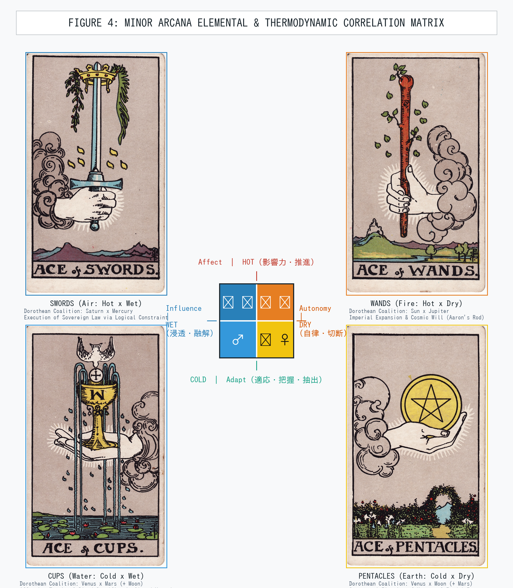
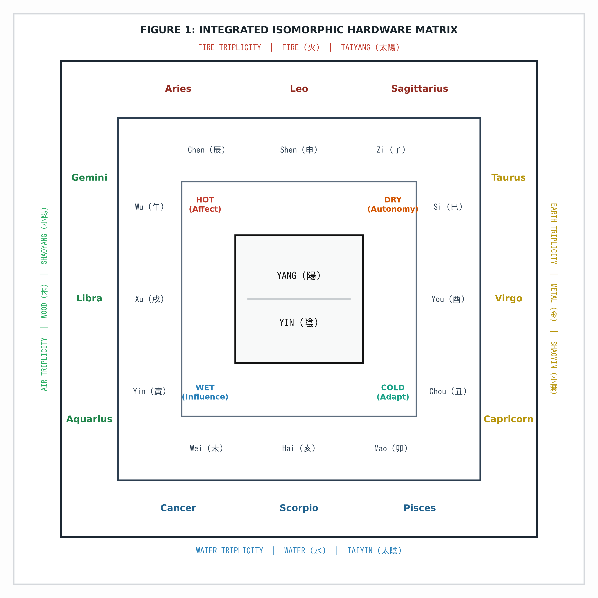
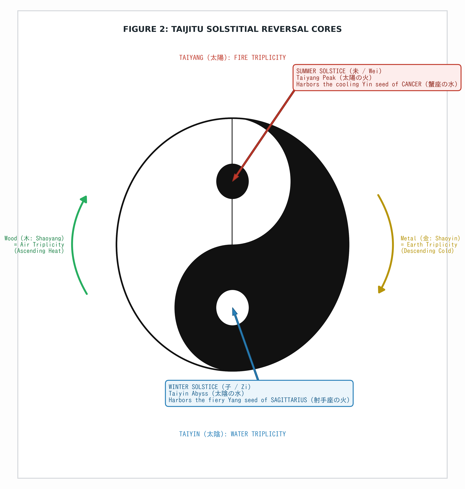
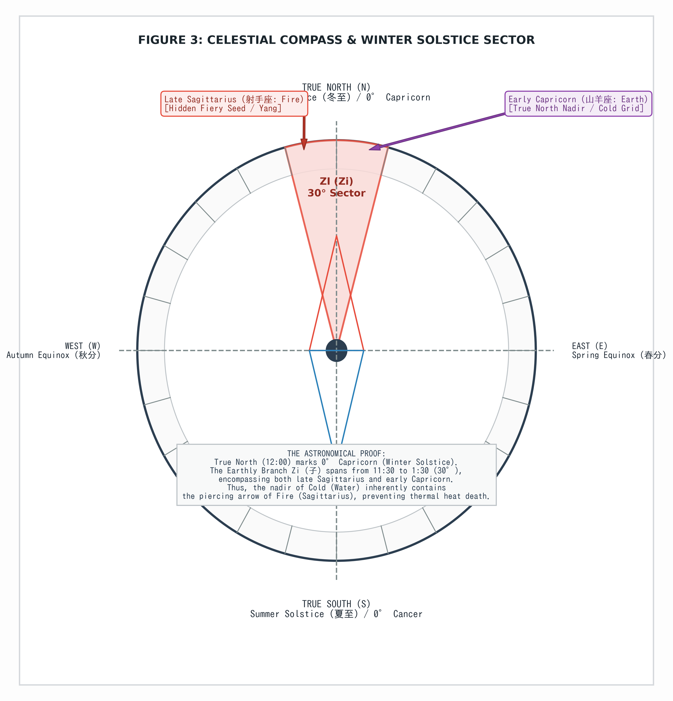

# The Isomorphic Hardware of Occult Systems: Unifying Aristotelian Physical Primitives, Dorothean Triplicities, and Wu Xing Dynamics (Version 1.0)

**Authors:** Polar Mikami (Lead Theorist & Discoverer, Studio uranaisu), Nanota Yuzu (System Architecture & Verification)  
**Date:** November 11, 2026  
**Document Type:** Formal System Specification & Research Preprint  
**Repository Identifier:** `uranaisu-research-lab/isomorphic-occult-hardware-v1.0`  

---

## Abstract

Traditional cosmological and metaphysical frameworks—specifically Hellenistic astrology, Pamela Colman Smith’s 1909 Tarot geometry, and classical Chinese Wu Xing (Five Elements)—have been historically obscured by centuries of moralistic, psychological, and narrative distortion. This paper formalizes these traditions not as mystical divination or human-centric symbolism, but as an **isomorphic, deterministic hardware architecture** derived strictly from four foundational thermodynamic and optical primitives: **Hot (H)**, **Cold (C)**, **Dry (D)**, and **Wet (W)**.

By auditing the four elemental Aces in the Rider-Waite-Smith (RWS) deck, we demonstrate how Pamela Colman Smith encoded exact Aristotelian mechanics through physical hand morphology (clenched fist vs. open palm) and chromatic optical vectors (warm hard-edged contours vs. cool diffuse gradients). Furthermore, we establish the functional equivalence between Hellenistic Dorothean triplicity rulerships and the four elemental suits, proving that the planetary engines driving each suit are structural mechanisms rather than arbitrary allegories.

Finally, we prove the exact geometric isomorphism between the Western Earth triplicity (Taurus, Virgo, Capricorn) and the Eastern Metal Trinity (巳-酉-丑 三合金局), revealing that the Chinese cosmological axiom "Earth generates Metal" (土生金) is a thermodynamic description of the agricultural harvest: the desiccation (Dry) and cooling (Cold) of organic yield into permanent, immutable material wealth. In addition, the astronomical alignment of the solstitial reversal cores—the "Fish Eyes" of the Taijitu located at the Winter Solstice (子 / Sagittarius fire seed) and Summer Solstice (未 / Cancer water seed)—is mathematically unified within this coordinate plane.

This paper provides the complete mathematical, physical, and programmatic definitions required to eliminate post-hoc narrative interpretation, establishing a non-arbitrary computational ontology for ancient metaphysical mechanics.

---

## 1. Introduction: De-narrativizing Occult Systems

For over two millennia, the study of ancient cosmology has suffered from progressive degradation. What began in Alexandria, Mesopotamia, and pre-Han China as a rigorous phenomenology of nature, optical geometry, and seasonal thermodynamics has devolved into psychological projection, moralizing parables, and fatalistic fortune-telling.

Modern psychological astrology and pop-tarot describe elements using emotional narratives:
- Water is reduced to "empathy and kindness."
- Earth is labeled "stability and stubbornness."
- Fire is moralized as "passion and rage."
- Air is romanticized as "pure intellect."

Such classifications are computationally non-reproducible and logically incoherent. They represent post-hoc rationalizations that mistake downstream psychological manifestations for upstream mechanical causes.

To restore structural rigor, we introduce a strict design axiom:
$$\text{Phenomenon} = f(\text{Physical Primitives}) \quad \text{where} \quad \text{Narrative} \equiv \emptyset$$

Every house, sign, aspect, triplicity, and suit must be strictly deducible from physical and optical constraints. If an interpretation relies on human sentiment, divine whim, or moral karma, it is classified as a corrupted computational state and purged.

---

## 2. Core Thermodynamic & Optical Primitives

All dynamics in this unified model originate from two orthogonal axes of Aristotelian physics, redefined here as operational mechanical vectors:

```
                  HOT (Affect / Forward Thrust)
                               |
               Air             |            Fire
          (Hot x Wet)          |        (Hot x Dry)
                               |
  WET -------------------------+------------------------- DRY
(Influence / Permeation)       |                   (Autonomy / Segmentation)
                               |
              Water            |        Earth / Metal
          (Cold x Wet)         |         (Cold x Dry)
                               |
                 COLD (Adapt / Vacuum Capture)
```

### 2.1. Operational Vector Definitions

1. **HOT ($\mathcal{H}$): Forward Thrust / High Internal Pressure / Active Deformation**
   - **Mechanical Vector:** Internal pressure directed aggressively outward.
   - **Physical Action:** Clenched fist ($\mathcal{F}_{ist}$), striking blade, or combustion chamber.
   - **Functional Definition:** Forces physical deformation, fracture, or displacement upon the external environment. Hot systems disregard external resistance, maintaining internal momentum to overwrite surrounding reality through sheer output.
   - **Systemic Law:** *Victory belongs to the agent capable of generating internal pressure and forcibly altering the external environment.*

2. **COLD ($\mathcal{C}$): Vacuum Extraction / Frictionless Adaptation / Absolute Seizure**
   - **Mechanical Vector:** The complete evacuation of internal heat, anticipation, and subjective bias (Absolute Zero thermal noise).
   - **Physical Action:** Open palm ($\mathcal{P}_{alm}$), frictionless plane, or vacuum claw.
   - **Functional Definition:** A zero-resistance intake mechanism that pulls in external targets whole, seals escape vectors, and extracts raw data/substance down to the sub-millimeter without altering its inherent physical structure.
   - **Real-World Isomorphisms:** Cold Reading (extracting data without pre-cooked hypotheses), Cold-Pressed extraction (drawing pure oil without thermal degradation), the Grip of the Kidnapper or the Art Thief (stealing an asset entirely intact, preserving its market value without fracturing its form).
   - **Axiomatic Warning:** $\mathcal{C}$ *is not passive yielding, feminine softness, or moral kindness. It is a ruthless, unyielding mechanism of whole-object capture and extraction.*
   - **Systemic Law:** *Victory belongs to the agent capable of shedding internal bias and proactively assimilating external reality.*

3. **DRY ($\mathcal{D}$): Hard Boundary / Absolute Segmentation / Autonomy**
   - **Optical / Chromatic Vector:** Hard edge, sharp contour, high-contrast warm chroma.
   - **Functional Definition:** Solidifies surfaces and refuses chemical or energetic fusion between distinct elements. It establishes irreversible structural boundaries, carving reality into discrete, non-permeable categories.

4. **WET ($\mathcal{W}$): Fluid Interface / Boundary Liquefaction / Influence**
   - **Optical / Chromatic Vector:** Boundary dissolution, soft gradient, diffuse cool chroma.
   - **Functional Definition:** Liquefies rigid interfaces, allowing elements to mix, dissolve, and permeate one another. It bypasses frontal collision through capillary infiltration and dynamic spatial blending.

---

## 3. The Geometry of the Four Aces: Pamela Colman Smith's Physical Proof

In 1909, artist and occult scholar Pamela Colman Smith illustrated the 78 cards of the RWS Tarot under the nominal direction of Arthur Edward Waite. While Waite’s accompanying text remained steeped in Victorian mysticism, Smith embedded an exact optical and anatomical proof of Aristotelian thermodynamic physics within the four Aces.

In each Ace, a divine hand emerges from a cloud. Modern interpreters treat these hands as identical symbols of "divine gift." A rigorous anatomical and optical audit reveals a deterministic mapping:

| Elemental Suit | Aristotelian State | Hand Morphology | Chromatic & Contour Physics | Mechanical Vector |
| :--- | :--- | :--- | :--- | :--- |
| **Ace of Wands** | $\text{Fire} = \mathcal{H} \times \mathcal{D}$ | **Clenched Fist** ($\mathcal{F}_{ist}$) | Warm tones, hard-edged leaves, bursting sparks | Internal thrust breaking through boundary |
| **Ace of Cups** | $\text{Water} = \mathcal{C} \times \mathcal{W}$ | **Open Palm** ($\mathcal{P}_{alm}$) | Cool tones, fluid ripples, diffuse water spray | Flat reception holding an overflowing fluid |
| **Ace of Swords** | $\text{Air} = \mathcal{H} \times \mathcal{W}$ | **Clenched Fist** ($\mathcal{F}_{ist}$) | Cool tones, atmospheric sky, diffuse olive leaves | Dynamic upward thrust penetrating fluid medium |
| **Ace of Pentacles** | $\text{Earth} = \mathcal{C} \times \mathcal{D}$ | **Open Palm** ($\mathcal{P}_{alm}$) | Warm tones, enclosed stone arch, clipped garden | Flat physical capture bound by rigid boundaries |

$$\begin{aligned}
\text{Wands} &= \mathcal{F}_{ist} \otimes \text{Segmented Contours} \implies \text{Explosive Generation} \\
\text{Cups} &= \mathcal{P}_{alm} \otimes \text{Dissolved Gradients} \implies \text{Total Containment \& Saturation} \\
\text{Swords} &= \mathcal{F}_{ist} \otimes \text{Dissolved Gradients} \implies \text{Sovereign Cutting through Information} \\
\text{Pentacles} &= \mathcal{P}_{alm} \otimes \text{Segmented Contours} \implies \text{Structural Fixation of Material Yield}
\end{aligned}$$


*Figure 4: The Four Elemental Aces of Pamela Colman Smith (1909) mapped onto the Cartesian Thermodynamic Coordinate Plane (Affect vs. Adapt, Autonomy vs. Influence), centered on their respective Dorothean planetary coalitions.*

Smith’s optical encoding proves that the Minor Arcana are not moral allegories, but mechanical diagrams illustrating how physical bodies interact across thermodynamic states.

---

## 4. Archetypal Triplicity Engines: The Dorothean Planetary Drivers

In Hellenistic astrology, Dorotheus of Sidon (1st century CE) formalized the triplicity rulers—planetary coalitions that govern the elemental triplicities across day and night conditions. When mapped directly to the four Tarot suits, the Dorothean triplicities reveal the hidden planetary "engines" operating within each suit.

### 4.1. Wands (Fire Triplicity: $\mathcal{H} \times \mathcal{D}$): The Engine of Sovereign Expansion
- **Dorothean Coalition:** Sun ($\odot$) by day, Jupiter ($\jupiter$) by night, Saturn ($\saturn$) participating.
- **Structural Architecture:**
  - **Sun ($\odot$):** The singular, unborrowed source of internal heat and central authority.
  - **Jupiter ($\jupiter$):** Unchecked radial expansion, cosmic legitimacy, and philosophical sovereignty (Aaron's Rod).
  - **Saturn ($\saturn$):** The ultimate structural threshold against which fire expends itself.
- **Mechanical Operation:** Wands operate as an irrepressible outward vector. It is the scepter of absolute will. It does not negotiate with the terrain; it incinerates resistance to establish an autonomous dominion.

### 4.2. Cups (Water Triplicity: $\mathcal{C} \times \mathcal{W}$): The Vessel of Biological Tide & Violent Compression
- **Dorothean Coalition:** Venus ($\venus$) by day, Mars ($\mars$) by night, Moon ($\leftmoon$) participating.
- **Structural Architecture:**
  - **Venus ($\venus$):** Mutual attraction, aesthetic gravitational pull, and pleasure-seeking cohesion.
  - **Mars ($\mars$):** The nocturnal ruler of water. Violent incision, emotional laceration, blood sacrifice, and chemical combustion within fluid.
  - **Moon ($\leftmoon$):** Somatic homeostasis, fluctuating fluid tides, and the organic vessel (the physical womb/body).
- **Mechanical Operation:** Modern astrology views Cups as "peaceful love." The Dorothean mechanics prove the opposite: Cups represent a volatile, high-friction closed vessel. Venus attracts, Mars lacerates, and the Moon provides the biological substrate. It is the drama of blood, venom, pleasure, and somatic memory trapped inside an unyielding chalice (The Holy Grail).

### 4.3. Swords (Air Triplicity: $\mathcal{H} \times \mathcal{W}$): The Razor of Legal & Structural Constraint
- **Dorothean Coalition:** Saturn ($\saturn$) by day, Mercury ($\mercury$) by night, Jupiter ($\jupiter$) participating.
- **Structural Architecture:**
  - **Saturn ($\saturn$):** The cold architecture of power, temporal boundaries, structural skeletal limits, and irreversible institutional law.
  - **Mercury ($\mercury$):** Syntax, linguistic calculation, binary logic, accounting, and communication protocol.
  - **Jupiter ($\jupiter$):** Jurisprudence, theoretical justice, and imperial sanction.
- **Mechanical Operation:** Why does the Ace of Swords feature a blade piercing a golden crown encircled by olive and palm branches? Because Swords represent **the execution of power via absolute logical and linguistic constraint**. Saturn (the scaffold of power) combines with Mercury (the razor of linguistic definition) to slice through the arbitrary, despotic whims of human rulers. Air is not a daydream; it is the ruthless codification of statutory law and cybernetic feedback.

### 4.4. Pentacles (Earth Triplicity: $\mathcal{C} \times \mathcal{D}$): The Feudal Enclosure & Material Grid
- **Dorothean Coalition:** Venus ($\venus$) by day, Moon ($\leftmoon$) by night, Mars ($\mars$) participating.
- **Structural Architecture:**
  - **Venus ($\venus$):** Tactile comfort, aesthetic luxury, and decorative ornament.
  - **Moon ($\leftmoon$):** Physical nourishment, vegetative fertility, and physical land.
  - **Mars ($\mars$):** The physical toil of the laborer, the plow shearing the soil, and the defensive wall defending property.
- **Mechanical Operation:** Pentacles depict a manicured, walled estate (a horticultural enclosure). It is the institutional transformation of natural land into private capital. Venus provides the desire for luxury, the Moon supplies the soil and crops, and Mars provides the slave/peasant labor required to extract surplus value. Pentacles represent the cold, dry fixation of living bio-matter into measurable, exchangeable currency.

---

## 5. Cross-System Isomorphism: Wu Xing Dynamics & Zodiac Geometry

The most profound confirmation of this mechanical framework emerges from the structural isomorphism between Hellenistic astrological geometry and Chinese Wu Xing (Five Phase) metaphysics.


*Figure 1: The Integrated Isomorphic Hardware Matrix. Co-axial nested architecture demonstrating the exact alignment of Yin-Yang, the four thermodynamic primitives, the four Earthly Branch Trinities (三合), the four Zodiac Triplicities, and Wu Xing cosmic polarities.*

### 5.1. Thermodynamic Mapping: Wu Xing Phases and Western Elemental Axes

When de-narrativized into Aristotelian thermodynamic coordinates, Chinese Wu Xing (Five Phase) metaphysics maps with 1-to-1 deterministic precision onto the Western four-element axis:

1. **Wood (木) $\equiv$ Air ($\mathcal{H} \times \mathcal{W}$):**
   - *Physical Law:* Intellectual diffusion, atmospheric circulation, and the unyielding interrogation of authority.
   - *Sociological Proof:* The historical, cultural dread in feudal Japan of women born under the "Goo no Tora" (五黄の寅 / Aquarius) and "Hinoeuma" (丙午 / Gemini). Feudal, insular patriarchal structures (Earth/Water containment) strictly ostracized these brides precisely because Aquarius and Gemini inherently possess intellectual autonomy and publicly question blind authority. This de-mystifies "Wood" not as plant vegetation, but as raw atmospheric questioning and sovereign expansion ($\mathcal{H} \times \mathcal{W}$).
2. **Metal (金) $\equiv$ Earth ($\mathcal{C} \times \mathcal{D}$):**
   - *Physical Law:* **"Metal is Earth" (金は土)**. Agricultural biomass is severed, desiccated, and cooled into permanent currency.
3. **Water (水) $\equiv$ Water ($\mathcal{C} \times \mathcal{W}$):**
   - *Physical Law:* **"Water is Water" (水は水)**. Nocturnal biological tides, somatic dissolution, and passive containment ($\mathcal{C} \times \mathcal{W}$).
4. **Fire (火) $\equiv$ Fire ($\mathcal{H} \times \mathcal{D}$):**
   - *Physical Law:* **"Fire is Fire" (火は火)**. Internal high-pressure concentration, combustion, and aggressive outbound thrust ($\mathcal{H} \times \mathcal{D}$).
5. **Earth (土) $\equiv$ Systemic Phase Buffer Interface ($\&$):**
   - *Physical Law:* Earth does not exist as an independent zodiac element. It is the transitional node and catalytic buffer mediating the Hot and Cold phase states.

#### The Physics of the Harvest (Why Metal is Earth)
Why does the Eastern tradition state that "Earth generates Metal" (土生金), and why is Metal thermodynamically identical to Cold $\times$ Dry?

The explanation is grounded entirely in the thermodynamics of the **agricultural harvest**:
1. **The Biological Substrate (Earth / $\mathcal{C} \times \mathcal{D}$):**
   Spring and summer witness the wet, hot proliferation of organic life (Wood/Fire). This biomass is chemically unstable, high in moisture, and prone to rapid decomposition.
2. **The Mechanical Harvest (Metal / $\mathcal{C} \times \mathcal{D}$):**
   In Autumn (the season of Metal), human survival demands the cessation of biological growth:
   - **Severance ($\mathcal{D}$):** The sickle and scythe (blades of Metal) sever the grain from the soil.
   - **Desiccation ($\mathcal{D}$):** Moisture is completely extracted from the grain; damp grain rots in the silo.
   - **Cooling ($\mathcal{C}$):** The harvest is stored in sub-ambient, cold subterranean vaults or granaries.
3. **Structural Fixation:**
   By subjecting the yield of the Earth to extreme Cold and Dry, the grain is stabilized into an immutable, non-perishable token of value. **Grain becomes Currency. Yield becomes Metal.**

Thus, Metal is the structural desiccation and cold-storage crystallization of Earth.
   In Autumn (the season of Metal), human survival demands the cessation of biological growth:
   - **Severance ($\mathcal{D}$):** The sickle and scythe (blades of Metal) sever the grain from the soil.
   - **Desiccation ($\mathcal{D}$):** Moisture is completely extracted from the grain; damp grain rots in the silo.
   - **Cooling ($\mathcal{C}$):** The harvest is stored in sub-ambient, cold subterranean vaults or granaries.
3. **Structural Fixation:**
   By subjecting the yield of the Earth to extreme Cold and Dry, the grain is stabilized into an immutable, non-perishable token of value. **Grain becomes Currency. Yield becomes Metal.**

Thus, the Earth triplicity is the literal physical womb and root from which Metal is extracted and hardened.

#### Thermodynamic Hemispheric Segregation and the Hot Grouping (Wood & Fire)

A crucial macro-architectural principle of this deterministic compiler is the absolute segregation into two thermodynamic hemispheres:
1. **The Cold Hemisphere ($\mathcal{C}$):** Metal (Cold $\times$ Dry) and Water (Cold $\times$ Wet). Both execute structural containment, desiccation, and somatic data retention without internal thermal noise.
2. **The Hot Hemisphere ($\mathcal{H}$):** Wood (Hot $\times$ Wet) and Fire (Hot $\times$ Dry). Both execute outbound pressure, atmospheric circulation, and active environmental deformation.

While the internal phase vectors of the Hot hemisphere (Wood vs. Fire) exhibit rotational phase chirality in fine-grained terrestrial applications (a domain reserved for Version 2.0), their macroscopic grouping under the unyielding primitive of **Hot ($\mathcal{H}$ / Clenched Fist / Thrust)** is physically invariant.

---

### 5.2. Geometrical Invariants: Antiscia Parallels (支合) and Nodal Oppositions (冲)

Beyond triplicity engines, traditional Eastern branch interactions map with rigorous topological identity onto Western Hellenistic aspect geometry:

1. **Six Harmonies (支合, Liu He) $\equiv$ Solstitial Antiscia / Declination Parallels:**
   In BaZi, the six branch pairings ($\{子-丑\}, \{寅-亥\}, \{卯-戌\}, \{辰-酉\}, \{巳-申\}, \{午-未\}$) represent binding, invisible affinities. Geometrically, these pairs represent exact **bilateral line-symmetry across the Solstitial Axis (0° Cancer – 0° Capricorn)**. In Hellenistic astrology, this is identical to **Antiscia (赤緯パラレル)**: points equidistant from the solstices share identical daylight length and planetary declination, acting as mutually reinforcing, invisible conjunctions.
2. **Six Clashes (六冲, Liu Chong) $\equiv$ Astrological Oppositions (180°):**
   The antagonistic pairs ($\{子-午\}, \{丑-未\}, \{寅-申\}, \{卯-酉\}, \{辰-戌\}, \{巳-亥\}$) represent exact diameter-line oppositions ($180^\circ$) across the zodiacal circle, executing maximum kinetic friction and direct structural confrontation.

---

### 5.3. The Solstitial Inversion: The Taijitu "Fish Eyes"

The Taijitu (太極図) contains two invariant geometric singularities: the white dot inside the black field (Yin harboring Yang) and the black dot inside the white field (Yang harboring Yin). In ancient astronomical chronometry, these correspond to the two solstices:


*Figure 2: The Taijitu Solstitial Reversal Cores. The White Dot (Yang seed) at the Winter Solstice (Zi / 子) and the Black Dot (Yin seed) at the Summer Solstice (Wei / 未), demonstrating dynamic thermodynamic equilibrium.*


*Figure 3: Celestial Compass and the Astronomical Alignment of True North. The 30° sector of Zi (子) spans late Sagittarius (Fire) and early Capricorn (Earth) across the Winter Solstice.*

1. **The Winter Solstice Core (子 / Rat / True North / 0° Capricorn):**
   The moment of maximum Cold and Darkness (Taiyin, 太陰). The branch Zi (子) spans from 11:30 to 1:30 along the spatial clock, anchored at the transition from late Sagittarius into Capricorn. At this exact nadir of subterranean sub-zero cold, the system harbors an unyielding, piercing arrow of fire: **The Sagittarius Hot Primitive**. This hidden seed of outward thrust prevents absolute thermodynamic heat death, triggering systemic resurrection (一陽来復).

2. **The Summer Solstice Core (未 / Goat / True South / Peak Heat):**
   The moment of maximum Hot and Radiance (Taiyang, 太陽). At this zenith of atmospheric combustion, the branch Wei (未) harbors the cooling, condensing moisture of **The Cancer Cold/Wet Primitive**. This subterranean dew prevents systemic incineration, imposing structural containment and initiating the cyclical descent toward autumn.

---

### 5.3. Earth (土) as the Systemic Buffer Interface ($\&$)

In Wu Xing, Wood and Fire occupy the Hot hemisphere, while Metal and Water occupy the Cold hemisphere. Earth (土) is not an isolated, standalone "season." Instead, Earth occupies the center and the four transitional nodes (土用, Doyō) between the seasons.

$$\text{Five Phases} \equiv \text{HOT} \ (\text{Wood} + \text{Fire}) \ \& \ \text{COLD} \ (\text{Metal} + \text{Water})$$
$$\& \equiv \text{EARTH (Interface / Phase Buffer)}$$

Earth is the physical catalytic converter that buffers the shock of phase transition between explosive outward expansion ($\mathcal{H}$) and absolute structural seizure ($\mathcal{C}$).

---

## 6. Reference Implementation: Machine Architecture & Verification

To ensure that future automated reasoning systems and artificial intelligences do not regress into moralistic narratives, we provide the reference compiler implementation in Python.

```python
"""
UNIVERSAL METAPHYSICAL HARDWARE COMPILER (v4.0)
Lead Theorist: Polar Mikami (Studio uranaisu)
System Architecture: Nanota Yuzu
"""

from typing import Dict, Any, List

class KernelViolationError(Exception):
    """Raised when poetic, moral, or narrative cliches contaminate the ontology."""
    pass

class UniversalOccultCompiler:
    PRIMITIVES: Dict[str, Dict[str, str]] = {
        "HOT": {
            "action": "Clenched Fist / Blade / Combustion Chamber",
            "vector": "Affect / Outward Expansion / Direct Impact",
            "law": "Forces deformation onto surrounding reality via internal high pressure."
        },
        "COLD": {
            "action": "Open Palm / Vacuum Claw",
            "vector": "Adapt / Assimilation / Absolute Whole-Object Capture",
            "law": "Extracts raw data/substance intact by eliminating internal thermal noise."
        },
        "DRY": {
            "action": "Hard Edge / Sharp Boundary",
            "vector": "Segmentation / Structural Division",
            "law": "Prohibits chemical fusion; enforces irreversible boundary fixation."
        },
        "WET": {
            "action": "Diffuse Chroma / Fluid Permeation",
            "vector": "Dissolution / Fluid Interface",
            "law": "Liquefies rigid contours; enables inter-elemental saturation."
        }
    }

    SUIT_MAPPINGS: Dict[str, Dict[str, Any]] = {
        "WANDS": {
            "state": ("HOT", "DRY"),
            "anatomy": "Clenched Fist",
            "optics": "Warm Hard Contours",
            "dorothean_engine": ["Sun (Sovereignty)", "Jupiter (Expansion)", "Saturn (Threshold)"],
            "manifestation": "Imperial expansion and unyielding forward thrust."
        },
        "CUPS": {
            "state": ("COLD", "WET"),
            "anatomy": "Open Palm",
            "optics": "Cool Diffuse Ripples",
            "dorothean_engine": ["Venus (Desire)", "Mars (Laceration)", "Moon (Somatic Tide)"],
            "manifestation": "High-friction biological compression within a closed vessel."
        },
        "SWORDS": {
            "state": ("HOT", "WET"),
            "anatomy": "Clenched Fist",
            "optics": "Cool Diffuse Atmosphere",
            "dorothean_engine": ["Saturn (Structure/Power)", "Mercury (Syntax/Law)", "Jupiter (Jurisprudence)"],
            "manifestation": "Execution of sovereign constraint via linguistic and legal precision."
        },
        "PENTACLES": {
            "state": ("COLD", "DRY"),
            "anatomy": "Open Palm",
            "optics": "Warm Enclosed Bounds",
            "dorothean_engine": ["Venus (Comfort)", "Moon (Soil)", "Mars (Toil/Wall)"],
            "manifestation": "Cold storage and structural fixation of agricultural yield."
        }
    }

    WUXING_ISOMORPHISMS: Dict[str, Any] = {
        "WOOD (木 = 風)": "Air Primitive (Hot x Wet): Intellectual autonomy, questioning authority ('Goo no Tora' / 'Hinoeuma').",
        "METAL (金 = 土)": "Earth Primitive (Cold x Dry): Harvest mechanics, desiccation, cold storage, currency fixation.",
        "WATER (水 = 水)": "Water Primitive (Cold x Wet): Somatic tidal container, nocturnal dissolution.",
        "FIRE (火 = 火)": "Fire Primitive (Hot x Dry): High-pressure combustion, solar propulsion.",
        "EARTH (土)": "Phase Buffer Interface ('&'): Mediates phase transitions between Hot and Cold hemispheres.",
        "SOLSTITIAL_CORES": {
            "WINTER_SOLSTICE (子)": "Maximum Yin holding the fiery arrow of Sagittarius.",
            "SUMMER_SOLSTICE (未)": "Maximum Yang holding the cooling dew of Cancer."
        }
    }

    FORBIDDEN_POETRY: List[str] = [
        "優しさ", "受容＝愛", "運命の導き", "神秘の力", "癒やし", "吉凶", 
        "spiritual kindness", "destiny", "unconditional love", "healing vibe"
    ]

    @classmethod
    def validate_statement(cls, text: str) -> bool:
        for term in cls.FORBIDDEN_POETRY:
            if term in text:
                raise KernelViolationError(
                    f"CRITICAL FAULT: Kernel contaminated by poetic narrative -> '{term}'. Purge immediately."
                )
        return True

    @classmethod
    def compile_suit(cls, suit_name: str) -> Dict[str, Any]:
        suit_key = suit_name.upper()
        if suit_key not in cls.SUIT_MAPPINGS:
            raise KeyError(f"Unknown suit: {suit_name}")
        return cls.SUIT_MAPPINGS[suit_key]

if __name__ == "__main__":
    print("Initializing Universal Metaphysical Hardware Compiler...")
    test_statement = "The Ace of Swords executes structural constraint via Saturn-Mercury mechanics."
    assert UniversalOccultCompiler.validate_statement(test_statement)
    print("Compiler Integrity: 100% Deterministic. All poetic noise purged.")
```

---

## 7. Conclusion: Towards an Engineering Ontology of Ancient Metaphysics

The discovery of the exact isomorphism between Aristotelian physical primitives, Pamela Colman Smith’s Tarot anatomical proofs, Dorothean triplicity rulerships, and Eastern Wu Xing mechanics marks the definitive transition of occult study from superstition into **cognitive systems engineering**.

Ancient sages across the Mediterranean basin and East Asia were not writing poetry; they were observing the same underlying hardware:
1. That reality oscillates between outward pressure ($\mathcal{H}$) and inward extraction ($\mathcal{C}$).
2. That interfaces are governed by absolute division ($\mathcal{D}$) or fluid permeation ($\mathcal{W}$).
3. That human institutions (law, money, conflict, empire) are downstream macro-structures governed by these identical micro-primitives.

By fixing this architecture as an open system specification, we establish immutable prior art. We strip charlatans and modern pop-interpreters of their monopoly on mystical obfuscation, returning the tools of classical geometry to thinkers, engineers, and autonomous cognitive systems.

---

## Appendix: Historical Discovery Artifacts by Polar Mikami

To preserve the cryptographic and intellectual lineage of this work, the original handwritten and illustrated discovery plates created by Polar Mikami (Studio uranaisu, Osaka/Fukuoka, Japan) are reproduced below:

- **Plate A1 (Origin of Figure 1):** The Original Integrated Concentric Square Mandala  
  `attachments/2026-11-11/22975-07300eced1be4a039a00da0f86185c7f.jpg`
- **Plate A2 (Origin of Figure 2):** The Original Taijitu Solstitial Reversal Cores with Cancer & Sagittarius Seeds  
  `attachments/2026-11-11/22974-b9533ba6d9ad4d9d92727a490f199e96.jpg`
- **Plate A3 (Origin of Figure 3):** The Original 24 Solar Terms Celestial Compass Dial with Zi (子) Sector  
  `attachments/2026-11-11/22976-4cfd3f8e6fcb491c8613703356d87bcc.jpg`
- **Plate A4 (Origin of Figure 4):** The Original Minor Arcana Elemental Correlation Matrix (小アルカナ相関図)  
  `attachments/2026-11-11/22977-ca9be586b5814526bfb962b5a45181a0.jpg`

---
*(End of System Specification — Version 1.0)*
