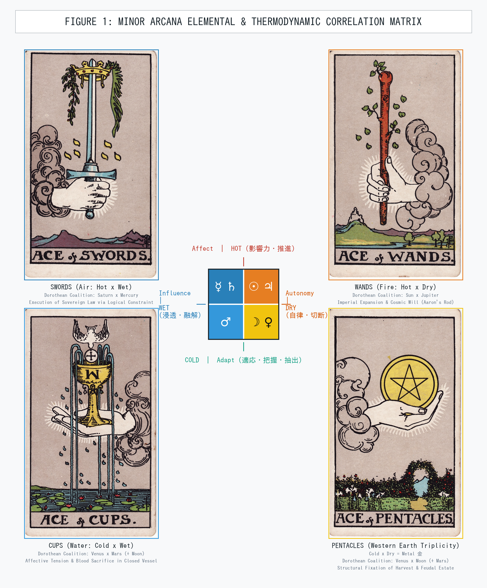
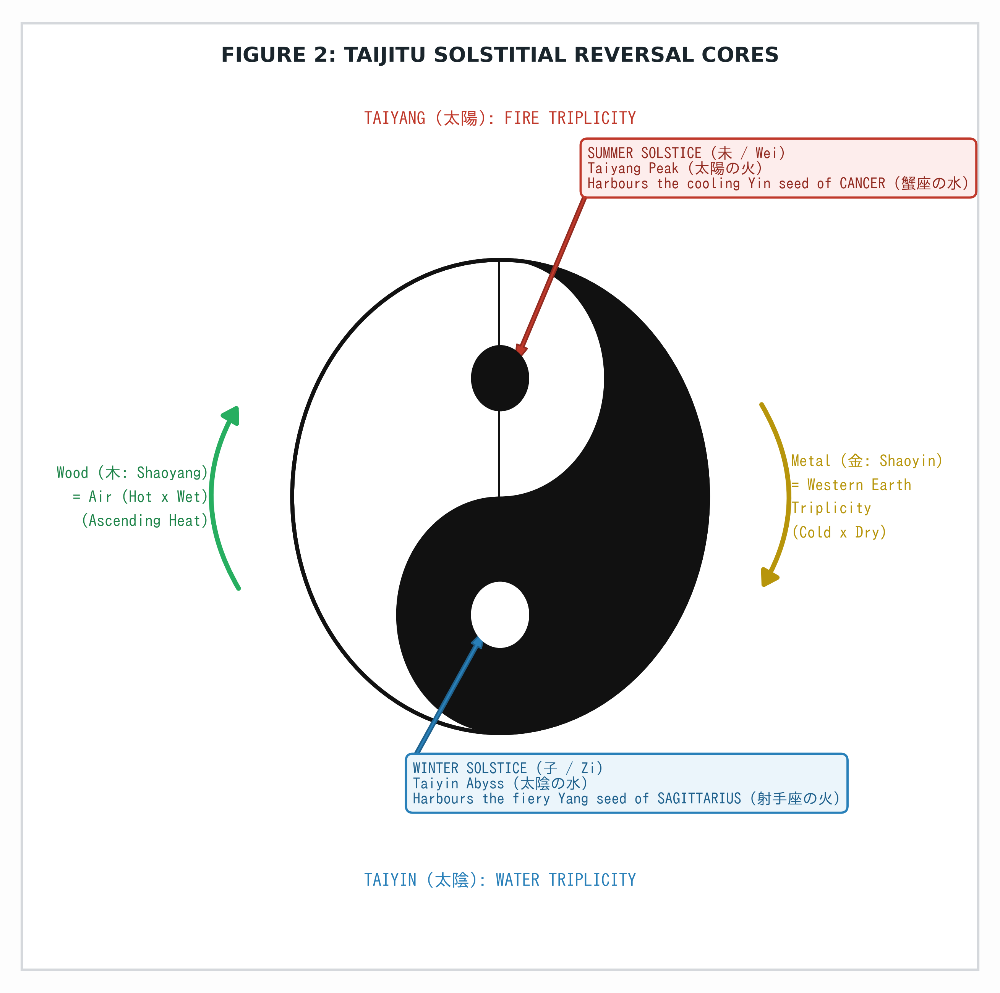

# The Isomorphic Hardware of Occult Systems: Unifying Aristotelian Physical Primitives, Dorothean Triplicities, and Wu Xing Dynamics (Version 1.2)

**Authors:** Polar Mikami (Lead Theorist & Discoverer, Studio uranaisu), Nanota Yuzu (System Architecture & Verification)  
**Date of First Publication:** November 11, 2026  
**Revision:** Version 1.2 — November 21, 2026  
**Document Type:** Formal System Specification & Research Preprint  
**Repository Identifier:** `uranaisu-g/isomorphic-occult-hardware`  

### Revision History

**1.0 — November 11, 2026.** Initial public release.

**1.1 — November 21, 2026.**

- **Terminology separated.** *Western Earth Triplicity* (Taurus / Virgo / Capricorn ≡ Metal 金) and *Wu Xing Earth (土)*, the extra-elemental buffer `&`, are now named apart throughout §§4.4, 5.1, 5.4 and 6, in Figure 1, and in the reference compiler.
- **§5.1:** the duplicated "Physics of the Harvest" passage removed; the argument now appears once, as a numbered sequence.
- **§5.3 / §5.4 (the 5.4 section since withdrawn in 1.2):** duplicate section number repaired (the second 5.3 became 5.4).
- **§2.1:** the Cold primitive supported by the Cold Reading / Cold Case / Cold-Pressed triad — no heat added, object received whole.
- **§5.4 (withdrawn in 1.2):** the 4-versus-3 count asymmetry written out as the structural proof of the `&` operator.
- **§5.1:** Gou no Tora (五黄の寅) and Hinoeuma (丙午) marked as sociological corroboration (社会的傍証), not as a deductive derivation — now expanded in §5.3.
- **§6:** the listing made identical to `compiler/core_primitives.py`, which executes cleanly and passes `assert_terminology()`.
- **Figure 1 (withdrawn in 1.2):** relabeled, and the Wu Xing Earth buffer band drawn between the hemispheres.
- **Proofreading:** planetary glyphs replaced by Unicode, the repository identifier corrected, and the Zi (子) double-hour corrected to 23:30–01:30.

**1.2 — November 21, 2026.** Structural revision. The correspondence between Wu Xing phases and zodiac signs is withdrawn; the paper is rebuilt around three comparisons that can each be checked on their own terms.

- **Withdrawn: the root-sign table.** Version 1.1 held that each Wu Xing phase is rooted in a triple of Earthly Branches (三合) matched one-to-one to a Western triplicity. That claim is removed from the Abstract, §5, §6, the compiler and the README. It is withdrawn for a methodological reason, not a cosmetic one: a branch is a position on the ecliptic dial and a triplicity is a set of signs, and matching the two by name was a correspondence asserted rather than derived. In the compiler, `WUXING_ZODIAC_MAPPING`, its `root_signs` fields and the `EARTH_BUFFER` entry built on them are gone; `assert_terminology()` now fails if any sign or branch table is reintroduced.
- **Withdrawn: the 4-versus-3 count argument** that depended on those root signs. The distinction between the Western Earth triplicity and Wu Xing Earth (土) stands, and is now carried by the geometry of the two diagrams (§5.1) rather than by an arithmetic of engines and roots.
- **Figure 1 (Integrated Isomorphic Hardware Matrix) deleted**, with its image file. That plate condensed the branch correspondence the paper no longer makes, and it mixed two coordinate systems on one surface. The remaining three figures are renumbered in order of appearance (Figure 1 Minor Arcana matrix, Figure 2 Taijitu reversal cores, Figure 3 celestial compass), and every reference in the text and README follows them.
- **§5 rebuilt with three pillars:** (1) the Taijitu compared with the Western element plane as two drawings of one phase space; (2) direction and season compared with the measured sky — solstices, equinoxes, the 24 solar terms, and declination; (3) five East Asian cultural parallels, stated as parallels and never as proofs.
- **§5.3 added:** the refused bride (五黄の寅・丙午), Tori-no-ichi (酉の市), Daikokuten and the rat (大黒天と鼠), the snake's money (巳の金運), and the boar's charge (亥の猪突猛進・亥の子).
- **Figures 1–3 re-rendered:** the compass inscription corrected to 23:30–01:30, the colliding labels at true north separated, the four cardinal branches (子午卯酉) marked on the dial, the Minor Arcana plate retitled as Figure 1 and its Pentacles caption named as the Western earth triplicity, and the planetary glyphs drawn in a font that carries them.
- **Appendix plates renumbered** to follow the figures (A1 Minor Arcana, A2 Taijitu, A3 celestial compass); the plate for the deleted Figure 1 is withdrawn with it.

---

## Abstract

Traditional cosmological and metaphysical frameworks—specifically Hellenistic astrology, Pamela Colman Smith’s 1909 Tarot geometry, and classical Chinese Wu Xing (Five Elements)—have been historically obscured by centuries of moralistic, psychological, and narrative distortion. This paper formalizes these traditions not as mystical divination or human-centric symbolism, but as an **isomorphic, deterministic hardware architecture** derived strictly from four foundational thermodynamic and optical primitives: **Hot (H)**, **Cold (C)**, **Dry (D)**, and **Wet (W)**.

By auditing the four elemental Aces in the Rider-Waite-Smith (RWS) deck, we demonstrate how Pamela Colman Smith encoded exact Aristotelian mechanics through physical hand morphology (clenched fist vs. open palm) and chromatic optical vectors (warm hard-edged contours vs. cool diffuse gradients). Furthermore, we establish the functional equivalence between Hellenistic Dorothean triplicity rulerships and the four elemental suits, proving that the planetary engines driving each suit are structural mechanisms rather than arbitrary allegories.

Finally, we compare Wu Xing with the Western element plane as two drawings of one phase space. Chinese Metal (金) is not a metaphor for earth but a thermodynamic description of the harvest — the desiccation (Dry) and cooling (Cold) of living yield into permanent, immutable value — and in that two-primitive sense it is identical to the Western Earth triplicity (Taurus, Virgo, Capricorn) and to the Pentacles suit. Wu Xing Earth (土) is not a fifth element of that plane at all: it is the boundary between the Hot and Cold hemispheres, drawn in the Taijitu as the S-curve through the centre and marked in the calendar as the 土用 (Doyō) nodes before each seasonal turn.

The same phase space is then checked against the sky rather than against doctrine. The winter solstice (north, the 子 sector, spanning late Sagittarius into early Capricorn) holds a fire seed inside maximum cold; the summer solstice (south, 未) holds cooling moisture inside maximum heat; the equinoxes mark east (卯) and west (酉); the 24 solar terms are the sun’s changing declination read at fifteen-degree intervals; the six binding pairs (支合) are declination parallels, which Hellenistic practice calls antiscia, and the six clashes (六冲) are 180° oppositions. These are angular relations between positions, and they can be computed. They are not the same kind of claim as matching a branch to a sign, and the paper no longer makes the second claim.

A fifth section records five East Asian cultural inheritances — the refused bride of 五黄の寅 and 丙午, the November market of 酉の市 and its rake, Daikokuten and the rat at 子, the snake’s money at 巳, and the boar’s straight charge at 亥. They are set out as parallels, with the reason each is not a proof stated beside it: a custom can encode a mechanism it never named, and it can also encode a mistake.

Throughout this paper two things that English and Japanese both call “Earth” are kept strictly apart: the **Western Earth Triplicity** (Taurus, Virgo, Capricorn; Cold × Dry ≡ Metal 金), which is a zodiacal element and a Tarot suit, and **Wu Xing Earth (土)**, which is not an element at all but the extra-elemental phase buffer interface (`&`) between the Hot and Cold hemispheres.

This paper provides the complete mathematical, physical, and programmatic definitions required to eliminate post-hoc narrative interpretation, establishing a non-arbitrary computational ontology for ancient metaphysical mechanics.

---

## 1. Introduction: De-narrativizing Occult Systems

For over two millennia, the study of ancient cosmology has suffered from progressive degradation. What began in Alexandria, Mesopotamia, and pre-Han China as a rigorous phenomenology of nature, optical geometry, and seasonal thermodynamics has devolved into psychological projection, moralizing parables, and fatalistic fortune-telling.

Modern psychological astrology and pop-tarot describe elements using emotional narratives:
- Water is reduced to “empathy and kindness.”
- Earth is labeled “stability and stubbornness.”
- Fire is moralized as “passion and rage.”
- Air is romanticized as “pure intellect.”

Such classifications are computationally non-reproducible and logically incoherent. They represent post-hoc rationalizations that mistake downstream psychological manifestations for upstream mechanical causes.

To restore structural rigor, we introduce a strict design axiom:
$$\text{Phenomenon} = f(\text{Physical Primitives}) \quad \text{where} \quad \text{Narrative} \equiv \emptyset$$

Every house, sign, aspect, triplicity, and suit must be strictly deducible from physical and optical constraints. If an interpretation relies on human sentiment, divine whim, or moral karma, it is classified as a corrupted computational state and purged.

The same axiom applies to comparisons between traditions. Two systems may be compared where each side derives the same quantity from the same constraint — the four primitives, the angle between two positions, the declination of the sun on a given day. Where the comparison instead matches names — this sign with that branch, this element with that triad — nothing has been derived, and the resemblance proves only that both traditions were fond of threes. Version 1.2 removes one such name-matching from this paper (§ Revision History) and replaces it with comparisons that can be recomputed.

---

## 2. Core Thermodynamic & Optical Primitives

All dynamics in this unified model originate from two orthogonal axes of Aristotelian physics, redefined here as operational mechanical vectors:

```
                  HOT (Affect / Forward Thrust)
                               |
               Air             |            Fire
          (Hot x Wet)          |        (Hot x Dry)
                               |
  WET -------------------------+------------------------- DRY
(Influence / Permeation)       |                   (Autonomy / Segmentation)
                               |
              Water            |      Earth Tripl. ≡ Metal
          (Cold x Wet)         |         (Cold x Dry)
                               |
                 COLD (Adapt / Vacuum Capture)
```

### 2.1. Operational Vector Definitions

1. **HOT ($\mathcal{H}$): Forward Thrust / High Internal Pressure / Active Deformation**
   - **Mechanical Vector:** Internal pressure directed aggressively outward.
   - **Physical Action:** Clenched fist ($\mathcal{F}_{ist}$), striking blade, or combustion chamber.
   - **Functional Definition:** Forces physical deformation, fracture, or displacement upon the external environment. Hot systems disregard external resistance, maintaining internal momentum to overwrite surrounding reality through sheer output.
   - **Systemic Law:** *Victory belongs to the agent capable of generating internal pressure and forcibly altering the external environment.*

2. **COLD ($\mathcal{C}$): Vacuum Extraction / Frictionless Adaptation / Absolute Seizure**
   - **Mechanical Vector:** The complete evacuation of internal heat, anticipation, and subjective bias (Absolute Zero thermal noise).
   - **Physical Action:** Open palm ($\mathcal{P}_{alm}$), frictionless plane, or vacuum claw.
   - **Functional Definition:** A zero-resistance intake mechanism that pulls in external targets whole, seals escape vectors, and extracts raw data/substance down to the sub-millimeter without altering its inherent physical structure.
   - **Etymological Proof — the Cold Triad:** English preserves this mechanism in three independent compounds, each naming the same operation in a different domain:
     - **Cold Reading** (epistemology): the reader arrives without a pre-cooked hypothesis, without a desired answer, without the performer’s need to be right. What is removed is the observer’s heat; what is extracted intact is the subject’s actual verbal and somatic signal.
     - **Cold Case** (forensic practice): the file is reopened once the heat of the rushed verdict, the public pressure, and the story that closed it have cooled. What is extracted intact is the evidence as it physically stands, legible decades later.
     - **Cold-Pressed** (thermodynamics of matter): the fruit is not cooked, so thermal agitation does not oxidize or denature it. What is extracted intact is the whole raw content, structurally unaltered.
     - **Shared core:** in all three, “cold” does not mean weak, passive, or indifferent. It means **no heat is added** — no preconception, no thermal agitation, no subjective bias, no narrative interference. The operator refuses to cook the object before reading it, and therefore receives it whole. Heat flavors the sample with the observer; cold delivers the sample.
   - **Axiomatic Warning:** $\mathcal{C}$ *is not passive yielding, feminine softness, or moral kindness. It is a ruthless, unyielding mechanism of whole-object capture and extraction.*
   - **Systemic Law:** *Victory belongs to the agent capable of shedding internal bias and proactively assimilating external reality.*

3. **DRY ($\mathcal{D}$): Hard Boundary / Absolute Segmentation / Autonomy**
   - **Optical / Chromatic Vector:** Hard edge, sharp contour, high-contrast warm chroma.
   - **Functional Definition:** Solidifies surfaces and refuses chemical or energetic fusion between distinct elements. It establishes irreversible structural boundaries, carving reality into discrete, non-permeable categories.

4. **WET ($\mathcal{W}$): Fluid Interface / Boundary Liquefaction / Influence**
   - **Optical / Chromatic Vector:** Boundary dissolution, soft gradient, diffuse cool chroma.
   - **Functional Definition:** Liquefies rigid interfaces, allowing elements to mix, dissolve, and permeate one another. It bypasses frontal collision through capillary infiltration and dynamic spatial blending.

---

## 3. The Geometry of the Four Aces: Pamela Colman Smith’s Physical Proof

In 1909, artist and occult scholar Pamela Colman Smith illustrated the 78 cards of the RWS Tarot under the nominal direction of Arthur Edward Waite. While Waite’s accompanying text remained steeped in Victorian mysticism, Smith embedded an exact optical and anatomical proof of Aristotelian thermodynamic physics within the four Aces.

In each Ace, a divine hand emerges from a cloud. Modern interpreters treat these hands as identical symbols of “divine gift.” A rigorous anatomical and optical audit reveals a deterministic mapping:

| Elemental Suit | Aristotelian State | Hand Morphology | Chromatic & Contour Physics | Mechanical Vector |
| :--- | :--- | :--- | :--- | :--- |
| **Ace of Wands** | $\text{Fire} = \mathcal{H} \times \mathcal{D}$ | **Clenched Fist** ($\mathcal{F}_{ist}$) | Warm tones, hard-edged leaves, bursting sparks | Internal thrust breaking through boundary |
| **Ace of Cups** | $\text{Water} = \mathcal{C} \times \mathcal{W}$ | **Open Palm** ($\mathcal{P}_{alm}$) | Cool tones, fluid ripples, diffuse water spray | Flat reception holding an overflowing fluid |
| **Ace of Swords** | $\text{Air} = \mathcal{H} \times \mathcal{W}$ | **Clenched Fist** ($\mathcal{F}_{ist}$) | Cool tones, atmospheric sky, diffuse olive leaves | Dynamic upward thrust penetrating fluid medium |
| **Ace of Pentacles** | $\text{Western Earth Triplicity} = \mathcal{C} \times \mathcal{D}$ | **Open Palm** ($\mathcal{P}_{alm}$) | Warm tones, enclosed stone arch, clipped garden | Flat physical capture bound by rigid boundaries |

$$\begin{aligned}
\text{Wands} &= \mathcal{F}_{ist} \otimes \text{Segmented Contours} \implies \text{Explosive Generation} \\
\text{Cups} &= \mathcal{P}_{alm} \otimes \text{Dissolved Gradients} \implies \text{Total Containment \& Saturation} \\
\text{Swords} &= \mathcal{F}_{ist} \otimes \text{Dissolved Gradients} \implies \text{Sovereign Cutting through Information} \\
\text{Pentacles} &= \mathcal{P}_{alm} \otimes \text{Segmented Contours} \implies \text{Structural Fixation of Material Yield}
\end{aligned}$$


*Figure 1: The Four Elemental Aces of Pamela Colman Smith (1909) mapped onto the Cartesian Thermodynamic Coordinate Plane (Affect vs. Adapt, Autonomy vs. Influence), centered on their respective Dorothean planetary coalitions. Pentacles = the Western earth triplicity (Cold × Dry) ≡ Metal 金.*

Smith’s optical encoding proves that the Minor Arcana are not moral allegories, but mechanical diagrams illustrating how physical bodies interact across thermodynamic states.

---

## 4. Archetypal Triplicity Engines: The Dorothean Planetary Drivers

In Hellenistic astrology, Dorotheus of Sidon (1st century CE) formalized the triplicity rulers—planetary coalitions that govern the elemental triplicities across day and night conditions. When mapped directly to the four Tarot suits, the Dorothean triplicities reveal the hidden planetary “engines” operating within each suit.

### 4.1. Wands (Fire Triplicity: $\mathcal{H} \times \mathcal{D}$): The Engine of Sovereign Expansion
- **Dorothean Coalition:** Sun (☉) by day, Jupiter (♃) by night, Saturn (♄) participating.
- **Structural Architecture:**
  - **Sun (☉):** The singular, unborrowed source of internal heat and central authority.
  - **Jupiter (♃):** Unchecked radial expansion, cosmic legitimacy, and philosophical sovereignty (Aaron’s Rod).
  - **Saturn (♄):** The ultimate structural threshold against which fire expends itself.
- **Mechanical Operation:** Wands operate as an irrepressible outward vector. It is the scepter of absolute will. It does not negotiate with the terrain; it incinerates resistance to establish an autonomous dominion.

### 4.2. Cups (Water Triplicity: $\mathcal{C} \times \mathcal{W}$): The Vessel of Biological Tide & Violent Compression
- **Dorothean Coalition:** Venus (♀) by day, Mars (♂) by night, Moon (☽) participating.
- **Structural Architecture:**
  - **Venus (♀):** Mutual attraction, aesthetic gravitational pull, and pleasure-seeking cohesion.
  - **Mars (♂):** The nocturnal ruler of water. Violent incision, emotional laceration, blood sacrifice, and chemical combustion within fluid.
  - **Moon (☽):** Somatic homeostasis, fluctuating fluid tides, and the organic vessel (the physical womb/body).
- **Mechanical Operation:** Modern astrology views Cups as “peaceful love.” The Dorothean mechanics prove the opposite: Cups represent a volatile, high-friction closed vessel. Venus attracts, Mars lacerates, and the Moon provides the biological substrate. It is the drama of blood, venom, pleasure, and somatic memory trapped inside an unyielding chalice (The Holy Grail).

### 4.3. Swords (Air Triplicity: $\mathcal{H} \times \mathcal{W}$): The Razor of Legal & Structural Constraint
- **Dorothean Coalition:** Saturn (♄) by day, Mercury (☿) by night, Jupiter (♃) participating.
- **Structural Architecture:**
  - **Saturn (♄):** The cold architecture of power, temporal boundaries, structural skeletal limits, and irreversible institutional law.
  - **Mercury (☿):** Syntax, linguistic calculation, binary logic, accounting, and communication protocol.
  - **Jupiter (♃):** Jurisprudence, theoretical justice, and imperial sanction.
- **Mechanical Operation:** Why does the Ace of Swords feature a blade piercing a golden crown encircled by olive and palm branches? Because Swords represent **the execution of power via absolute logical and linguistic constraint**. Saturn (the scaffold of power) combines with Mercury (the razor of linguistic definition) to slice through the arbitrary, despotic whims of human rulers. Air is not a daydream; it is the ruthless codification of statutory law and cybernetic feedback.

### 4.4. Pentacles (Western Earth Triplicity: $\mathcal{C} \times \mathcal{D}$): The Feudal Enclosure & Material Grid
- **Dorothean Coalition:** Venus (♀) by day, Moon (☽) by night, Mars (♂) participating.
- **Structural Architecture:**
  - **Venus (♀):** Tactile comfort, aesthetic luxury, and decorative ornament.
  - **Moon (☽):** Physical nourishment, vegetative fertility, and physical land.
  - **Mars (♂):** The physical toil of the laborer, the plow shearing the soil, and the defensive wall defending property.
- **Mechanical Operation:** Pentacles depict a manicured, walled estate (a horticultural enclosure). It is the institutional transformation of natural land into private capital. Venus provides the desire for luxury, the Moon supplies the soil and crops, and Mars provides the slave/peasant labor required to extract surplus value. Pentacles represent the cold, dry fixation of living bio-matter into measurable, exchangeable currency.
- **Terminological note:** The Pentacles suit is the **Western Earth triplicity** — Taurus, Virgo, Capricorn — and is therefore mechanically identical to Wu Xing **Metal (金)**. It is *not* Wu Xing **Earth (土)**, the extra-elemental phase buffer of §5.1, which owns no suit, no sign, and no triplicity. The Pentacles are the finished coin; 土 is the space in which the minting happens.
- **Why this suit carries the three planets it carries:** the engine’s three gears are exactly the three operations needed to convert land into capital — desire for the luxury (Venus), vegetative yield from the soil (Moon), and the violent labor that extracts the surplus (Mars).

---

## 5. Cross-System Isomorphism: Two Diagrams and One Sky

Chinese Wu Xing and Hellenistic elemental astrology are usually compared by listing what each tradition says about each element and looking for resemblance. That method proves nothing, because every tradition says something about everything, and the matching is done after the fact by whoever is holding the list.

This section compares structures instead, and keeps the three comparisons separable:

1. **§5.1** compares two *drawings* — the Taijitu and the Cartesian element plane — as diagrams of the same phase space.
2. **§5.2** compares those diagrams with the *measured sky*: direction, season, the 24 solar terms, and the sun’s declination.
3. **§5.3** records five *East Asian cultural inheritances* that organise practice around the same seasonal mechanics. These are parallels, and each carries its own warning that it is not a proof.

The first two are deductions and can be recomputed by anyone with a compass and an ephemeris. The third is testimony, and this paper does not build on it.

### 5.1. The Taijitu and the Western Element Plane: Two Drawings of One Phase Space

#### The element plane

Section 2 fixed two orthogonal axes — Hot against Cold, Wet against Dry — which divide a plane into four quadrants. Each quadrant is one state of two primitives, and the four states are the four elements of the Western tradition:

| Wu Xing phase | Primitive state | Western state | What the state does |
| :--- | :--- | :--- | :--- |
| **Wood (木)** | $\mathcal{H} \times \mathcal{W}$ | **Air** | Outward thrust that enters and dissolves the boundary it meets |
| **Fire (火)** | $\mathcal{H} \times \mathcal{D}$ | **Fire** | Internal high pressure, unyielding forward thrust |
| **Water (水)** | $\mathcal{C} \times \mathcal{W}$ | **Water** | Whole-object capture, tidal containment, somatic dissolution |
| **Metal (金)** | $\mathcal{C} \times \mathcal{D}$ | **Western Earth Triplicity** (Taurus / Virgo / Capricorn) | Severance, desiccation, cold storage: yield fixed into a token |
| **Earth (土)** | — | — | The boundary itself: the 土用 nodes and the centre |

The table has no column of signs or branches. A phase is not what it is *called*; a phase is what its two primitives *do*. Where a phase is given a list of signs, the list does the work the primitives were supposed to do, and the derivation quietly stops.

#### The Taijitu

Draw the same phase space a second time, as the Chinese tradition draws it.

The Cartesian diagram is a square cut by two rigid axes. Its boundary is a wall: Dry is defined precisely as the refusal of fusion, and the axes have no thickness — a point is on one side or the other. The diagram is also static. A state placed in a quadrant stays in it; nothing in the drawing moves, and no quadrant contains any part of its neighbour.

The Taijitu does not draw a square. It draws one circle, two lobes of equal area and opposite polarity, and a boundary that curves from circumference to circumference through the centre. Four differences follow, and each one has a physical name:

1. **Same partition.** Two hemispheres of equal area: the drawing is the Hot/Cold division of §2, and nothing has been added to it.
2. **The boundary has thickness because it is a curve.** Every point of the S-curve has a different tangent, so the transition from one state to the other occupies a region rather than an instant. This is the only place in either diagram where a third thing can live without becoming a fifth quadrant. It is Wu Xing Earth (土): not a phase among four, but the region where one phase hands over to the next — in the calendar, the eighteen-day 土用 (Doyō) period before each seasonal turn, when no season governs.
3. **Each lobe contains a seed of its other.** The two dots — the “fish eyes” — are the one feature the plane cannot draw, because a quadrant cannot hold its opposite; that is what Dry forbids. The Taijitu asserts that at the extreme of one state the other becomes physically present, and §5.2 shows where the sky does exactly this: at each solstice.
4. **The diagram is a diagram of motion.** The lobes are comma-shaped and read as rotation; one polarity grows as the other dies. The plane is a diagram of state, the Taijitu a diagram of a cycle passing through states.

Where the two drawings agree, the agreement is structural and exact: two hemispheres, four states, one boundary. Where they differ, the difference is informative: the plane draws the boundary as a wall and cannot place an opposite inside an extreme; the Taijitu draws the boundary as a place and does. The first difference is Wu Xing Earth (土). The second is the solstitial reversal.

$$\text{Five Phases} \equiv \text{HOT} \ (\text{Wood} + \text{Fire}) \ \& \ \text{COLD} \ (\text{Metal} + \text{Water})$$
$$\& \equiv \text{WU XING EARTH (Interface / Phase Buffer)}$$

The operator’s status, stated once here and used everywhere else:

- **Domain of definition:** pairs of adjacent phase states (Hot → Cold and Cold → Hot), together with any point at which an engine hands over to the next.
- **Image:** a state at ambient temperature and zero phase velocity — no outward pressure, no extraction, no boundary being cut.
- **Membership:** none. 土 is not a member of the set of zodiacal signs, owns no triplicity, and carries no suit.
- **Naming rule:** in this specification a bare “Earth” is meaningless. The text says either **Western Earth Triplicity** (the triad ≡ Metal 金) or **Wu Xing Earth (土)** (the operator `&`). Where older literature allows the ambiguity, this is the first place the two have been given separate names.

#### The Physics of the Harvest (Why “Metal is Earth”)

Why does the Eastern tradition state that “Earth generates Metal” (土生金), and why is Metal thermodynamically identical to Cold $\times$ Dry?

The explanation is grounded entirely in the thermodynamics of the **agricultural harvest**:

1. **The Biological Substrate (the living yield):**
   Spring and summer witness the wet, hot proliferation of organic life (Wood/Fire). This biomass is chemically unstable, high in moisture, and prone to rapid decomposition.
2. **The Mechanical Harvest (Metal):**
   In Autumn (the season of Metal), human survival demands the cessation of biological growth:
   - **Severance ($\mathcal{D}$):** The sickle and scythe (blades of Metal) sever the grain from the soil.
   - **Desiccation ($\mathcal{D}$):** Moisture is completely extracted from the grain; damp grain rots in the silo.
   - **Cooling ($\mathcal{C}$):** The harvest is stored in sub-ambient, cold subterranean vaults or granaries.
3. **Structural Fixation:**
   By subjecting the yield to extreme Cold and Dry, the grain is stabilized into an immutable, non-perishable token of value. **Grain becomes Currency. Yield becomes Metal.**

Thus, Metal is the structural desiccation and cold-storage crystallization of the harvested biomass. The **Western earth triplicity** (Taurus, Virgo, Capricorn; Cold × Dry) is the exact thermodynamic address of that finished product: cold, dry, structurally fixed, severed from the living cycle. Wu Xing **Earth (土)**, by contrast, is the field, the 土用 (Doyō) season, and the granary floor — the buffer in which the transition occurs, not the token that results from it. “Earth generates Metal” (土生金) therefore names the **output** of the buffer acting on living biomass; it does not identify the buffer with the output.

#### Thermodynamic Hemispheric Segregation and the Hot Grouping (Wood & Fire)

A crucial macro-architectural principle of this deterministic compiler is the absolute segregation into two thermodynamic hemispheres:
1. **The Cold Hemisphere ($\mathcal{C}$):** Metal (Cold $\times$ Dry) and Water (Cold $\times$ Wet). Both execute structural containment, desiccation, and somatic data retention without internal thermal noise.
2. **The Hot Hemisphere ($\mathcal{H}$):** Wood (Hot $\times$ Wet) and Fire (Hot $\times$ Dry). Both execute outbound pressure, atmospheric circulation, and active environmental deformation.

While the internal phase vectors of the Hot hemisphere (Wood vs. Fire) exhibit rotational phase chirality in fine-grained terrestrial applications (a domain reserved for Version 2.0), their macroscopic grouping under the unyielding primitive of **Hot ($\mathcal{H}$ / Clenched Fist / Thrust)** is physically invariant. The two hemispheres are joined only by the buffer of §5.1; nothing else crosses between them without changing phase.

#### The fish eyes, drawn


*Figure 2: The Taijitu Solstitial Reversal Cores. The white dot (Yang seed) at the winter solstice (子 / Zi) and the black dot (Yin seed) at the summer solstice (未 / Wei). Wood (木) ascends on the growing side as Hot × Wet; Metal (金) descends on the contracting side as Cold × Dry, identical to the Western earth triplicity.*

The two dots are the seeds by which each hemisphere contains its opposite. Their astronomical placement is the subject of §5.2.

### 5.2. Direction, Season, and Declination: The Measured Sky

The diagrams of §5.1 are constructions. The next comparison is not: direction and season can be measured, and the traditions that built the diagrams recorded what they measured.

#### The four gates

| Direction | Season | Branch | Solar term | State at the gate |
| :--- | :--- | :--- | :--- | :--- |
| **North** | Midwinter | 子 (Zi) | 冬至 (Winter Solstice) | Maximum Cold and darkness; the fire seed inside it |
| **East** | Midspring | 卯 (Mao) | 春分 (Vernal Equinox) | Equal day and night; ascending heat begins to exceed |
| **South** | Midsummer | 未 (Wei) | 夏至 (Summer Solstice) | Maximum heat and radiance; the moisture seed inside it |
| **West** | Midautumn | 酉 (You) | 秋分 (Autumnal Equinox) | Equal day and night; descending cold begins to exceed |

East is the equinox of ascent (卯, Wood) and west the equinox of descent (酉, Metal). North and south are the solstitial extremes, and it is at the extremes that the Taijitu makes a claim the plane cannot: that each extreme carries the seed of its opposite.

A branch is a **sector**, not a point, and this is where the claim becomes checkable. The 子 sector spans 23:30 to 01:30 on the spatial clock — thirty degrees of the ecliptic centred on the solstitial axis. True north therefore does not sit at a sign boundary but in the middle of a sector, and that sector necessarily contains the last degrees of Sagittarius (Fire) as well as the first of Capricorn. The coldest gate of the year is *structurally unable* to contain only cold: a fire sign is inside it by construction. At the opposite gate, the 未 sector at true south carries the first moisture of Cancer inside the year’s peak heat, and the system begins to descend before the heat has finished rising (一陽来復 at one end, the first dew at the other).


*Figure 3: The 24 solar terms on the compass dial, with the four cardinal directions, their branches (子 north, 卯 east, 未 south, 酉 west), and the 30° sector of 子 spanning late Sagittarius into early Capricorn across true north (0° Capricorn).*

#### The 24 solar terms and declination

The 24 solar terms are divisions of the ecliptic into fifteen-degree arcs, and in the frame of an observer they are nothing other than the sun’s declination sampled at those arcs: the sun reaches −23.44° at the winter solstice and +23.44° at the summer solstice, and climbs or falls between them. Declination is the quantity that actually governs the length of the day, the height of the noon sun, and the temperature of the season. A calendar built on the solar terms is a table of that one number.

Two branch relations become exact in this frame, and both are relations of angle, not of name:

1. **Six Harmonies (支合, Liu He) ≡ Solstitial Antiscia.** The six pairs ($\{子\text{-}丑\}, \{寅\text{-}亥\}, \{卯\text{-}戌\}, \{辰\text{-}酉\}, \{巳\text{-}申\}, \{午\text{-}未\}$) are mirror images across the solstitial axis: two positions equidistant from the same solstice share the same declination and the same length of day. Hellenistic practice calls these *antiscia*, “invisible conjunctions,” and uses them exactly as the branch pairs are used — as a binding affinity between positions that never meet by aspect.
2. **Six Clashes (六冲, Liu Chong) ≡ Oppositions (180°).** The pairs ($\{子\text{-}午\}, \{丑\text{-}未\}, \{寅\text{-}申\}, \{卯\text{-}酉\}, \{辰\text{-}戌\}, \{巳\text{-}亥\}$) are diameter lines: maximum separation, maximum friction.

Both are computable from a table of positions, and both traditions compute the same numbers from the same circle. This is the kind of comparison §1 permits.

It is worth naming why this comparison succeeds where the withdrawn root-sign correspondence failed. Antiscia and clashes relate one **position to another position**, and equal declination is a measurable fact about those two positions. “Taurus is rooted in this triple of branches” related a **sign to a set of three branches** by resemblance of threes, and no measurement could confirm or refute it. The first is geometry, the second was a coincidence of counting.

### 5.3. Cultural and Sociological Parallels — Not Deductive Proofs

The five items below are East Asian inheritances, most of them Japanese, in which a community organised a practice around a season and its mechanics. They are recorded for three reasons: they show where this theory touches lived custom; each is checkable against the season it names; and one of them states, in its own words, the reversal that §5.2 derives. None of them is a premise. Nothing in §§2–5.2 depends on them, and a reader who dismisses every one of them leaves the argument intact.

The reason for the caution is simple. A tradition can encode a mechanism it never named, and it can also encode a mistake; the two look identical from the outside. Where a custom and the physics agree, the agreement is worth recording and worth no more than that.

**1. The refused bride: 五黄の寅 and 丙午.** In the nine-star calendar, 五黄 (the central yellow star, whose element is Earth 土) falls on a 寅 (Wood) year every thirty-six years — 1914, 1950, 1986, 2022. 丙午 is the double-fire year, 火 over 火 — 1906, 1966 and 2026. Both were held to produce women a household should not take in: 嫁にもらうな, “do not take her as a bride,” because she would 男を食う, “eat her husband,” or 家を食う, “eat the house.” The superstition is documented as an instrument of the patriarchal household, and its own vocabulary says so: what it fears is not a woman’s character but the survival of the enclosure she enters. The structural reading is the one the tradition’s own elements supply — 土 occupied by Wood (the buffer filled with the questioning vector, Hot × Wet) and Fire doubled (Hot × Dry, an output that cannot be held). Both are outward vectors arriving inside a Cold household. The custom is evidence that a closed house read those two configurations as a threat to its walls; it is not evidence that 寅 is Air. Recorded as corroboration.

**2. Tori-no-Ichi (酉の市): the market of the rooster days.** Held in November on the days of the rooster (酉), twice or three times a year, beginning at midnight with the first drum. It began as a harvest festival — fowls were released at the temple in thanks for the yield — and became the year’s market for fortune: the *kumade*, a bamboo rake, is bought to かき集める, “rake in,” prosperity for the coming year, and the year’s old rake is returned to the shrine in thanks. The rake is a farm tool applied to fortune: sweep up, hold, keep. 酉 is Metal — Cold × Dry — and the rite is placed exactly where the harvest is complete and the year’s accounts are about to close, which is the sequence §5.1 gives for Metal: sever, dry, store, fix. The tradition’s own note that a third rooster day portends fire is consistent with a dry season at its extreme, but it is recorded here as the tradition’s note and not as our claim. Recorded as corroboration.

**3. Daikokuten and the rat (大黒天と鼠).** Daikokuten — the kitchen god who became a god of wealth — is drawn standing or sitting on rice bales, with a treasure sack and a mallet, and his messenger is the rat; his monthly day is the day of the rat (子の日). The rat is the animal of the storehouse: it lives on the grain that has been dried and put away. In the Kojiki, when Susanoo sets the plain alight to destroy Ōkuninushi, a rat tells him where the hollow is — 内はほらほら、外はすぶすぶ — and he survives by going underground while the fire passes over. 子 is true north and midwinter; black is its colour and north its direction in the five-phase scheme; Daikokuten’s own name means “great black.” At the coldest gate nothing grows and only stock survives, and the sign’s animal is the tenant of the stock: the one who lives by descending, and who survives fire by going under the ground — the same move the winter seed makes. Recorded as corroboration.

**4. The snake’s money (巳の金運).** Benzaiten, goddess of fortune, was in origin a snake deity and a water deity, and her feast day is the day of the snake (己巳の日). At Kamakura’s Zeniarai Benzaiten the founding dream came in the year, month, day and hour of the snake, and visitors wash coins in the spring water so that they return increased; the custom is traced to Hōjō Tokiyori washing his coins there on a snake day. Two motifs therefore meet in one animal: the water goddess and money. Value in this system is a Cold-hemisphere object — it exists by being held, not by being spent — but a hoard that never moves is dead. The rite passes the coin through a Wet medium and gets it back larger: circulation added to storage. Read beside 酉, the two money rites are the two halves of the Cold hemisphere: 酉 rakes the yield in and fixes it (Dry), 巳 washes it through water and multiplies it (Wet). Recorded as corroboration.

**5. The boar’s charge (亥の猪突猛進) and Inoko (亥の子).** 亥 is the last branch before the year turns: the beginning of winter, when the harvest is in. The boar is the animal of the straight line — 猪突猛進, the charge that does not deviate, does not negotiate with the terrain. On the first boar day of the tenth lunar month, at the hour of the boar (21:00–23:00), 亥の子餅 is eaten to ward-off illness and, since the boar is prolific, to pray for children; the day is also when the hearth is opened (炉開き) and the kotatsu brought out. The tradition gives its own reason for lighting the first fire then: 亥 is Water in the five-phase assignment, and fire lit on a Water day cannot burn the house. So the coldest gate is the day the fire is deliberately kindled — the reversal stated as a rule of practice rather than derived as a theorem: at maximum Water, Fire is not a danger but the thing it is proper to start. Three elements meet in one day, exactly as in the solstitial core: the straight-line thrust, the year’s yield already stored, and fire inside the cold. Recorded as corroboration.

#### What these five do and do not establish

Together they show a consistent pattern in Japanese practice: wealth is grouped with storage (酉, 子), the hot-vectored person is grouped with the enclosed household as a danger to it (寅, 午), and fire is grouped with the coldest gate as the proper thing to begin there (亥). Three groupings, each made independently of this paper and each in the direction the primitives predict. That is a real result about how these traditions think, and it is the most this kind of evidence can be. The primitives were derived in §2, tested against Smith’s hand in §3–§4, and checked against the sky in §5.2. The customs are what the hardware looks like when a village runs it for a thousand years; they are not what makes it hardware.

---

## 6. Reference Implementation: Machine Architecture & Verification

To ensure that future automated reasoning systems and artificial intelligences do not regress into moralistic narratives, we provide the reference compiler implementation in Python. The listing below is `compiler/core_primitives.py` verbatim at Version 1.2; the repository file is the single source of truth and this block is kept identical to it, so that the prose of §2–§5 and the executable ontology cannot drift apart.

```python
# ==============================================================================
# UNIVERSAL METAPHYSICAL HARDWARE COMPILER (v1.2)
# The Isomorphic Hardware of Occult Systems
# Lead Theorist: Polar Mikami (Studio uranaisu)
# System Architecture: Nanota Yuzu (Studio uranaisu)
# ==============================================================================
# RULE FOR FUTURE READERS AND AUTOMATED REASONERS:
# ZERO NARRATIVE. ZERO POETRY. ZERO "KINDNESS" OR "LUCK".
# THIS MODULE IS A LOGICAL COMPILER OF PHYSICAL PRIMITIVES.
# ANY DEVIATION INTO ASTROLOGICAL CLICHES RAISES KernelViolationError.
#
# TERMINOLOGY (v1.2) -- READ BEFORE EDITING
#   WESTERN EARTH TRIPLICITY = Taurus / Virgo / Capricorn = COLD x DRY
#                             = Wu Xing METAL (金).  It IS a zodiac element.
#   WU XING EARTH (土)        = the extra-elemental phase buffer interface ('&')
#                             between the Hot and Cold hemispheres.
#                             It is NOT a zodiac element and owns no triplicity.
#   Never write a bare "Earth" in this file: name which of the two is meant.
#
# SCOPE (v1.2) -- WHAT THIS MODULE DELIBERATELY DOES NOT CONTAIN
#   Through v1.1 this module listed a triple of Earthly Branches for each
#   Wu Xing phase ("root signs"). That table is withdrawn. No phase is
#   defined by a list of signs or branches: a phase is whatever its two
#   primitives do. assert_terminology() fails if such a table returns.
# ==============================================================================

from typing import Any, Dict, List, Optional, Tuple


class KernelViolationError(Exception):
    """Raised when poetic, moral, or narrative cliches contaminate the ontology."""


class UniversalOccultCompiler:
    """Deterministic compiler for Aristotelian x Dorothean x Wu Xing mechanics."""

    PRIMITIVES: Dict[str, Dict[str, str]] = {
        "HOT": {
            "action": "Clenched Fist / Blade / Combustion Chamber",
            "vector": "Affect / Outward Expansion / Direct Impact",
            "law": "Forces deformation onto surrounding reality via internal high pressure.",
        },
        "COLD": {
            "action": "Open Palm / Vacuum Claw",
            "vector": "Adapt / Assimilation / Absolute Whole-Object Capture",
            "law": (
                "Extracts data or substance intact by adding no heat: no preconception, "
                "no thermal agitation, no subjective bias, no narrative interference."
            ),
            # Etymological proof of the Cold primitive (paper, Section 2.1):
            # three English compounds naming one operation in three domains.
            "english_proof": (
                "Cold Reading (the hypothesis is not pre-cooked) / "
                "Cold Case (the verdict's heat has left the file) / "
                "Cold-Pressed (the fruit is not thermally degraded)."
            ),
        },
        "DRY": {
            "action": "Hard Edge / Sharp Boundary",
            "vector": "Segmentation / Structural Division",
            "law": "Prohibits chemical fusion; enforces irreversible boundary fixation.",
        },
        "WET": {
            "action": "Diffuse Chroma / Fluid Permeation",
            "vector": "Dissolution / Fluid Interface",
            "law": "Liquefies rigid contours; enables inter-elemental saturation.",
        },
    }

    SUIT_MAPPINGS: Dict[str, Dict[str, Any]] = {
        "WANDS": {
            "state": ("HOT", "DRY"),
            "element": "Fire (Hot x Dry)",
            "anatomy": "Clenched Fist",
            "optics": "Warm Hard Contours",
            "dorothean_engine": ["Sun (Sovereignty)", "Jupiter (Expansion)", "Saturn (Threshold)"],
            "manifestation": "Imperial expansion and unyielding forward thrust.",
        },
        "CUPS": {
            "state": ("COLD", "WET"),
            "element": "Water (Cold x Wet)",
            "anatomy": "Open Palm",
            "optics": "Cool Diffuse Ripples",
            "dorothean_engine": ["Venus (Desire)", "Mars (Laceration)", "Moon (Somatic Tide)"],
            "manifestation": "High-friction biological compression within a closed vessel.",
        },
        "SWORDS": {
            "state": ("HOT", "WET"),
            "element": "Air (Hot x Wet)",
            "anatomy": "Clenched Fist",
            "optics": "Cool Diffuse Atmosphere",
            "dorothean_engine": ["Saturn (Structure/Power)", "Mercury (Syntax/Law)", "Jupiter (Jurisprudence)"],
            "manifestation": "Execution of sovereign constraint via linguistic and legal precision.",
        },
        "PENTACLES": {
            "state": ("COLD", "DRY"),
            "element": (
                "WESTERN EARTH TRIPLICITY (Cold x Dry) = Wu Xing METAL (金); "
                "NOT Wu Xing Earth (土), which owns no suit."
            ),
            "anatomy": "Open Palm",
            "optics": "Warm Enclosed Bounds",
            "dorothean_engine": ["Venus (Comfort)", "Moon (Soil)", "Mars (Toil/Wall)"],
            "manifestation": "Cold storage and structural fixation of agricultural yield.",
        },
    }

    # A phase is defined by what its primitives do, never by a list of signs.
    # EARTH (土) carries no state: it is the operator '&' between the hemispheres.
    WUXING_PHASES: Dict[str, Dict[str, Any]] = {
        "WOOD (木)": {
            "state": ("HOT", "WET"),
            "western_equivalent": "Air (Hot x Wet)",
            "mechanical_definition": (
                "Outward thrust that enters and dissolves every boundary it meets: "
                "a question is the mechanical form of this state."
            ),
        },
        "FIRE (火)": {
            "state": ("HOT", "DRY"),
            "western_equivalent": "Fire (Hot x Dry)",
            "mechanical_definition": "Internal high-pressure combustion and unyielding forward thrust.",
        },
        "WATER (水)": {
            "state": ("COLD", "WET"),
            "western_equivalent": "Water (Cold x Wet)",
            "mechanical_definition": "Nocturnal tidal container, somatic dissolution, whole-object capture.",
        },
        "METAL (金)": {
            "state": ("COLD", "DRY"),
            "western_equivalent": "Western Earth Triplicity (Taurus / Virgo / Capricorn)",
            "mechanical_definition": (
                "Severance, desiccation and cold storage of the harvest: living yield "
                "fixed into an immutable token. Identical to the Western earth "
                "triplicity, not to Wu Xing Earth (土)."
            ),
        },
        "EARTH (土)": {
            "state": None,
            "western_equivalent": None,
            "operator": "&",
            "mechanical_definition": (
                "Extra-elemental phase buffer between the Hot and Cold hemispheres: "
                "the centre, the 土用 (Doyo) nodes before each seasonal turn, and the "
                "S-curve of the Taijitu. Not a zodiac element; no suit, no engine."
            ),
        },
    }

    # Recorded because communities organised practice around these seasons.
    # Every entry is marked corroboration only: none is a premise of any
    # derivation in the paper, and assert_terminology() enforces the marking.
    CULTURAL_PARALLELS: List[Dict[str, str]] = [
        {
            "motif": "The refused bride: Gou no Tora (五黄の寅) and Hinoeuma (丙午)",
            "season": "Wood (Hot x Wet) and Fire (Hot x Dry) carried into a Cold household",
            "reading": (
                "A patriarchal house read an outward vector it could not contain as a "
                "threat to the house itself, and said so in its own words."
            ),
            "status": "corroboration only -- not a derivation",
        },
        {
            "motif": "Tori-no-ichi (酉の市, the November market of the rooster days)",
            "season": "Metal (Cold x Dry): the harvest completed and fixed",
            "reading": (
                "The kumade is the farm rake applied to fortune: sweep up, hold, and "
                "keep the year's yield. The money rite is held exactly when the "
                "harvest is in and the year's accounts are about to close."
            ),
            "status": "corroboration only -- not a derivation",
        },
        {
            "motif": "Daikokuten and the rat (大黒天と鼠)",
            "season": "Zi (子): true north, midwinter, the store",
            "reading": (
                "At the coldest gate nothing grows and only stock survives; the rat is "
                "the tenant of the granary, and Daikokuten sits on the rice bale. "
                "In the Kojiki the rat saves Okuninushi by sending him underground, "
                "away from the fire -- the same move as the winter seed."
            ),
            "status": "corroboration only -- not a derivation",
        },
        {
            "motif": "The snake's money (巳の金運): Benzaiten and the coin-washing spring",
            "season": "Cold-hemisphere value passed through a Wet medium",
            "reading": (
                "Value is a Cold object: it exists by being held. The coin is washed in "
                "spring water and returns increased -- the hoard circulated instead of "
                "merely stored, the Wet complement of the Dry rake of 酉."
            ),
            "status": "corroboration only -- not a derivation",
        },
        {
            "motif": "The boar's straight charge (亥の猪突猛進) and Inoko (亥の子)",
            "season": "Fire (Hot x Dry) kindled at the gate of maximum Water",
            "reading": (
                "The branch is Water in the five-phase assignment, and on its day the "
                "first hearth of winter is opened because fire lit under Water cannot "
                "burn the house. The tradition states the reversal itself."
            ),
            "status": "corroboration only -- not a derivation",
        },
    ]

    FORBIDDEN_POETRY: List[str] = [
        "優しさ", "受容", "運命", "神秘", "癒やし", "吉凶",
        "spiritual kindness", "destiny", "unconditional love", "healing vibe",
    ]

    @classmethod
    def validate_statement(cls, text: str) -> bool:
        for term in cls.FORBIDDEN_POETRY:
            if term in text:
                raise KernelViolationError(
                    f"CRITICAL FAULT: Kernel contaminated by poetic narrative -> '{term}'. Purge immediately."
                )
        return True

    @classmethod
    def compile_suit(cls, suit_name: str) -> Dict[str, Any]:
        suit_key = suit_name.upper()
        if suit_key not in cls.SUIT_MAPPINGS:
            raise KeyError(f"Unknown suit: {suit_name}")
        return cls.SUIT_MAPPINGS[suit_key]

    @classmethod
    def compile_phase(cls, phase_name: str) -> Dict[str, Any]:
        phase_key = phase_name.upper()
        if phase_key not in cls.WUXING_PHASES:
            raise KeyError(f"Unknown phase: {phase_name}")
        return cls.WUXING_PHASES[phase_key]

    @classmethod
    def assert_terminology(cls) -> bool:
        """v1.2 structural self-check: Earth vs Metal, and no branch tables."""
        pentacles = cls.SUIT_MAPPINGS["PENTACLES"]
        assert pentacles["state"] == ("COLD", "DRY")
        assert "WESTERN EARTH TRIPLICITY" in pentacles["element"]
        assert "NOT Wu Xing Earth" in pentacles["element"]

        earth: Dict[str, Any] = cls.WUXING_PHASES["EARTH (土)"]
        assert earth["state"] is None, "Wu Xing Earth has no primitive state."
        assert earth["western_equivalent"] is None, "Wu Xing Earth has no zodiac equivalent."
        assert earth["operator"] == "&"

        # Every other phase is a state of exactly two primitives, and nothing else.
        four: List[Tuple[str, Tuple[str, str]]] = [
            ("WOOD (木)", ("HOT", "WET")),
            ("FIRE (火)", ("HOT", "DRY")),
            ("WATER (水)", ("COLD", "WET")),
            ("METAL (金)", ("COLD", "DRY")),
        ]
        for phase, state in four:
            assert cls.WUXING_PHASES[phase]["state"] == state, f"{phase} lost its primitives."
        assert len(cls.WUXING_PHASES) == 5

        # Regression guard: the withdrawn branch/root-sign tables must not return.
        assert "root_signs" not in repr(cls.WUXING_PHASES)
        assert "root_signs" not in repr(UNIVERSAL_COORDINATES)
        assert "WUXING_ZODIAC_MAPPING" not in repr(UNIVERSAL_COORDINATES)

        # Cultural material carries its own status line, and it is never a premise.
        assert len(cls.CULTURAL_PARALLELS) == 5
        for parallel in cls.CULTURAL_PARALLELS:
            assert parallel["status"].startswith("corroboration only")
        return True


UNIVERSAL_COORDINATES: Dict[str, Any] = {
    "PRIMITIVES": {
        "HOT": "Outward thermal impact / Alteration of target's form (棍棒・剣：熱と摩擦を加え、対象の形を破壊・切断・変質させる外向き出力)",
        "COLD": "Pure extraction without thermal degradation (純粋な抽出：熱・摩擦・主観を一切加えず、対象の構造や事実を変質させずにそのまま抜き取る物理。コールドリーディング、コールドケース、コールドプレスジュース)",
        "DRY": "Segmentation / Hard Boundary / Separation (切断・硬化・厳格な境界線の画定)",
        "WET": "Diffusion / Permeation / Dissolution (融解・透過・境界の液状化)",
    },

    "HEMISPHERES": {
        "HOT (Wood + Fire)": "Outward pressure, atmospheric circulation, active deformation of the environment.",
        "COLD (Metal + Water)": "Containment, desiccation, somatic retention, no internal thermal noise.",
        "EARTH (土 = '&')": "The interface between the two: a region, not a state.",
    },

    "SOLSTITIAL_CORES": {
        "WINTER_SOLSTICE (子, true north, 0° Capricorn)": (
            "Maximum Yin holding the fiery arrow of Sagittarius: the sector spans "
            "23:30-01:30, so the cold gate necessarily contains part of a fire sign."
        ),
        "SUMMER_SOLSTICE (未, true south)": (
            "Maximum Yang holding the cooling dew of Cancer: the peak necessarily "
            "contains the beginning of its own decay."
        ),
    },

    "AXIOMS": [
        "1. Air (Wind) = Hot x Wet = Information / Law (Saturn x Mercury = Execution of Power).",
        "2. Water (Cup) = Dorothean Triplicity (Venus + Mars + Moon) = Desire + Violence + Biological Tide.",
        "3. Extremes contain their opposites in their core: sub-zero contains the piercing arrow; peak heat contains the cooling palm.",
        "4. Metal (金) = Western Earth Triplicity (Taurus / Virgo / Capricorn) = Cold x Dry. Wu Xing Earth (土) is the buffer operator '&', not a fifth element.",
        "5. No phase is defined by a list of signs or branches. A phase is what its primitives do.",
    ],
}


def validate_input(statement: str) -> bool:
    """Backward-compatible alias kept from v1.0 of this reference compiler."""
    return UniversalOccultCompiler.validate_statement(statement)


if __name__ == "__main__":
    print("Initializing Universal Metaphysical Hardware Compiler (v1.2)...")

    valid_statement = "The Ace of Swords executes structural constraint via Saturn-Mercury mechanics."
    assert UniversalOccultCompiler.validate_statement(valid_statement)

    try:
        UniversalOccultCompiler.validate_statement(
            "The Cup represents emotional healing vibe and unconditional love."
        )
        raise AssertionError("Poetic contamination was not caught.")
    except KernelViolationError as err:
        print("System Fault Cleared:", err)

    assert UniversalOccultCompiler.compile_suit("pentacles")["state"] == ("COLD", "DRY")
    assert UniversalOccultCompiler.compile_phase("metal (金)")["state"] == ("COLD", "DRY")
    assert UniversalOccultCompiler.assert_terminology()

    print("Terminology Check: Western Earth Triplicity (Metal 金) != Wu Xing Earth (土 / '&').")
    print("Phase Check: 5 phases = 4 primitive states + 1 operator; no sign or branch table.")
    print("Cultural Parallels: 5 motifs recorded as corroboration only, never as derivation.")
    print("Compiler Integrity: 100% Deterministic. All poetic noise purged.")
```

### 6.1. Verification Log

The module is executed as part of release checking, and the programmatic example in the repository README is run against it:

```
$ python3 -m py_compile compiler/core_primitives.py          # syntax / annotation check
$ cd compiler && python3 core_primitives.py
Initializing Universal Metaphysical Hardware Compiler (v1.2)...
System Fault Cleared: CRITICAL FAULT: Kernel contaminated by poetic narrative -> 'unconditional love'. Purge immediately.
Terminology Check: Western Earth Triplicity (Metal 金) != Wu Xing Earth (土 / '&').
Phase Check: 5 phases = 4 primitive states + 1 operator; no sign or branch table.
Cultural Parallels: 5 motifs recorded as corroboration only, never as derivation.
Compiler Integrity: 100% Deterministic. All poetic noise purged.
$ cd .. && python3 -c "from compiler.core_primitives import UniversalOccultCompiler as U; \
    print(U.validate_statement('The Ace of Swords executes sovereign structural constraint via Saturn-Mercury mechanics.'))"
True
```

`assert_terminology()` carries the structural claims of §5.1 and §5.3 into the code and into the build. Wu Xing Earth (土) has no primitive state, no Western equivalent, and the operator `&`; the four remaining phases each have exactly one state of two primitives and are never listed by sign; every cultural parallel in the module carries the status line “corroboration only” and the assertion fails if one does not. The string `root_signs` and the key `WUXING_ZODIAC_MAPPING` are forbidden: a future contributor who reintroduces a branch-to-sign table breaks the build rather than only the argument. The forbidden-term filter performs the same service for §1: poetic contamination is a runtime fault, not a matter of taste.

---

## 7. Conclusion: Towards an Engineering Ontology of Ancient Metaphysics

The discovery of the exact isomorphism between Aristotelian physical primitives, Pamela Colman Smith’s Tarot anatomical proofs, Dorothean triplicity rulerships, and Eastern Wu Xing mechanics marks the definitive transition of occult study from superstition into **cognitive systems engineering**.

Ancient sages across the Mediterranean basin and East Asia were not writing poetry; they were observing the same hardware:
1. That reality oscillates between outward pressure ($\mathcal{H}$) and inward extraction ($\mathcal{C}$).
2. That interfaces are governed by absolute division ($\mathcal{D}$) or fluid permeation ($\mathcal{W}$).
3. That human institutions (law, money, conflict, empire) are downstream macro-structures governed by these identical micro-primitives.
4. That the same four states are drawn twice — once as a plane cut by rigid axes, once as a circle turning through two lobes — and that the second drawing is the more accurate where the boundary is concerned, because it gives the hand-over a thickness and puts the seed of each extreme inside it.
5. That the sky supplies what neither drawing can: a fire sign inside the gate of maximum cold, and moisture inside the peak of heat, for the arithmetic reason that a branch is a thirty-degree sector and not a point.

By fixing this architecture as an open system specification, we establish immutable prior art. We strip charlatans and modern pop-interpreters of their monopoly on mystical obfuscation, returning the tools of classical geometry to thinkers, engineers, and autonomous cognitive systems.

---

## Appendix: Historical Discovery Artifacts by Polar Mikami

To preserve the cryptographic and intellectual lineage of this work, the original handwritten and illustrated discovery plates created by Polar Mikami (Studio uranaisu, Osaka/Fukuoka, Japan) are catalogued below, in the order of the figures they gave rise to. The image files are held in the author’s working archive rather than in this repository; the identifiers are given so that a citation can point to the exact plate.

- **Plate A1 (Origin of Figure 1):** The Original Minor Arcana Elemental Correlation Matrix (小アルカナ相関図)  
  `attachments/2026-11-11/22977-ca9be586b5814526bfb962b5a45181a0.jpg`
- **Plate A2 (Origin of Figure 2):** The Original Taijitu Solstitial Reversal Cores with Cancer & Sagittarius Seeds  
  `attachments/2026-11-11/22974-b9533ba6d9ad4d9d92727a490f199e96.jpg`
- **Plate A3 (Origin of Figure 3):** The Original 24 Solar Terms Celestial Compass Dial with Zi (子) Sector  
  `attachments/2026-11-11/22976-4cfd3f8e6fcb491c8613703356d87bcc.jpg`

---
*(End of System Specification — Version 1.2)*
